# Baseline geometry and screening results

This is a deterministic 2D baseline study. No optimization or global-optimality claim is made.

Validated 2026-10-18: **97 tests passed in 21.79 s**; Ruff checks and format checks passed.
The full configured run completed **135 PDE solves**, with maximum relative conservation
error **5.97e-11**. Run directory:
`experiments/20261018T190141820531Z_baseline_shapes_11d19deb/`.

Reproduce from the repository root:

```powershell
.\.venv\Scripts\python.exe -m oxygen_shape.cli compare-shapes --config configs/baseline_shapes.yaml
```

Machine-readable copies retained in this repository:
[metrics](data/baseline_metrics.csv), [refinement](data/baseline_refinement.csv),
[rankings](data/baseline_rankings.csv), and [summary](data/baseline_summary.json).

## Declared comparisons

All cases use the unit bounding box, fixed source x=0, 0.45<=y<=0.55 (length 0.1), u=1, and Robin conditions on every other exposed face. Grids: [100, 200, 400]. Bi: [0.01, 0.1, 1.0, 10.0, 100.0]. Seed metadata: 42; no randomness is consumed.

**fixed_area:** seven shapes with area 0.24 (tolerance 1e-12) and Robin perimeter <= 18. Actual membrane length and occupied diameter vary. This is a common-budget comparison, not an equal-membrane comparison.

**fixed_perimeter:** rectangle and square with target Robin length 3, within 4h on each grid. Area varies. The matching tolerance and measured errors are stored; small flux differences can reflect that mismatch.

All masks include the same source corridor to x=0.55; the deep cavity extends its neck to x=0.70. Shape labels describe the attached body, including its connecting corridor.

## Finest-grid metrics

### fixed_area

| Shape | Area | Robin length | Diameter | Q (Bi=0.01) | Q (Bi=0.1) | Q (Bi=1) | Q (Bi=10) | Q (Bi=100) |
|---|---:|---:|---:|---:|---:|---:|---:|---:|
| rectangle | 0.24 | 2.34 | 0.941488 | 0.02219676 | 0.1541564 | 0.4880064 | 1.333962 | 3.27104 |
| disk | 0.24 | 2.56 | 0.812408 | 0.02388291 | 0.1526671 | 0.4616505 | 1.332485 | 3.271085 |
| square | 0.24 | 2.37 | 0.825538 | 0.02221407 | 0.1455482 | 0.4572769 | 1.332436 | 3.271085 |
| sinusoidal | 0.24 | 3.02 | 0.941488 | 0.0280975 | 0.1766047 | 0.4972311 | 1.334094 | 3.271039 |
| branching | 0.24 | 4.355 | 0.970824 | 0.03761491 | 0.1802625 | 0.475235 | 1.337061 | 3.270876 |
| hilbert | 0.24 | 7.54 | 1.00963 | 0.04924331 | 0.202238 | 0.5092927 | 1.33566 | 3.271028 |
| deep_cavity | 0.24 | 2.97 | 1.00985 | 0.02638926 | 0.1424836 | 0.4445963 | 1.332403 | 3.271085 |

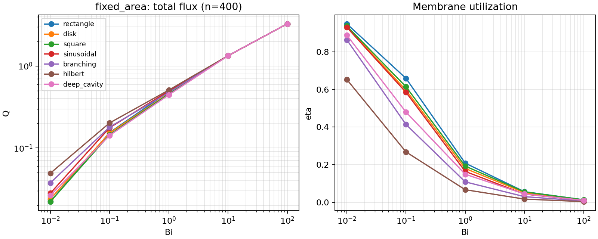

### fixed_perimeter

| Shape | Area | Robin length | Diameter | Q (Bi=0.01) | Q (Bi=0.1) | Q (Bi=1) | Q (Bi=10) | Q (Bi=100) |
|---|---:|---:|---:|---:|---:|---:|---:|---:|
| rectangle | 0.4842 | 3 | 0.98976 | 0.02807052 | 0.1805376 | 0.5013297 | 1.33357 | 3.271035 |
| square | 0.463975 | 2.995 | 0.961828 | 0.02785814 | 0.1743579 | 0.484435 | 1.332835 | 3.271078 |

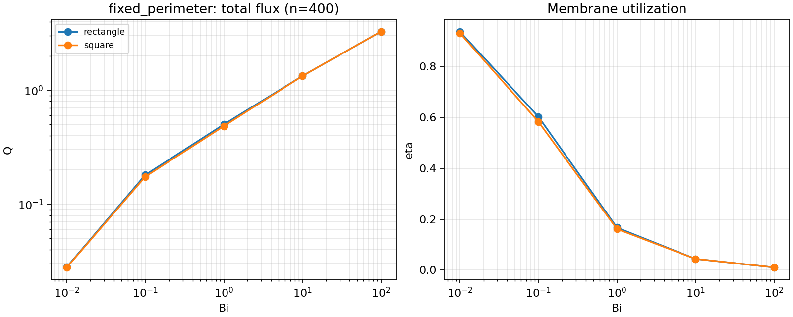

## Screening and utilization

The screened fraction below is the fraction of Robin length with wall u<0.1; it is a diagnostic threshold, not an optimization rule.

| Comparison | Shape | eta at lowest Bi | eta at highest Bi | wall fraction u<0.1 at highest Bi |
|---|---|---:|---:|---:|
| fixed_area | rectangle | 0.948579 | 0.0139788 | 0.961538 |
| fixed_area | disk | 0.932926 | 0.0127777 | 0.964844 |
| fixed_area | square | 0.937302 | 0.013802 | 0.962025 |
| fixed_area | sinusoidal | 0.930381 | 0.0108313 | 0.970199 |
| fixed_area | branching | 0.863718 | 0.00751062 | 0.979334 |
| fixed_area | hilbert | 0.653094 | 0.00433823 | 0.988064 |
| fixed_area | deep_cavity | 0.888527 | 0.0110138 | 0.969697 |
| fixed_perimeter | rectangle | 0.935684 | 0.0109034 | 0.97 |
| fixed_perimeter | square | 0.930155 | 0.0109218 | 0.96995 |

## Refinement and uncertainty

Largest relative Q change on the final refinement: **2.102%**. Cases exceeding the 5% warning threshold: **0**. This threshold is a reporting flag, not proof of convergence.

| Comparison | Shape | max final Q change over Bi | max final Robin length change |
|---|---|---:|---:|
| fixed_area | rectangle | 2.102% | 0% |
| fixed_area | disk | 2.102% | 0% |
| fixed_area | square | 2.102% | 0.4219% |
| fixed_area | sinusoidal | 2.102% | 1.325% |
| fixed_area | branching | 2.102% | 0.3444% |
| fixed_area | hilbert | 2.102% | 0% |
| fixed_area | deep_cavity | 2.102% | 0% |

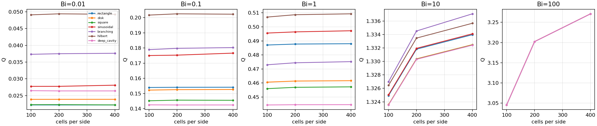

| fixed_perimeter | rectangle | 2.102% | 0% |
| fixed_perimeter | square | 2.102% | 0.5008% |

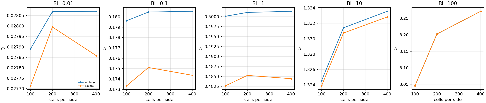

`refinement.csv` reports area drift, eta changes, and field differences after averaging 2x2 fine cells. Fields are compared only where the coarse cell and all four fine cells are inside; coverage is reported. Regenerated masks can shift by a raster layer. Successive-grid changes are sensitivity estimates, not rigorous continuum error bounds.

Full rank orderings on the last two grids and their stability are in `rankings.csv`. A stable ordering alone does not establish a resolved difference: compare flux gaps with grid changes and resource-matching error before interpreting a ranking.

## Interpretation of this run

- Increasing Bi raises Q and reduces eta for every fixed geometry. At the highest
  Bi, most of the distal membrane is screened; the fields and face data show that
  utilization is concentrated near the source.
- At Bi=1 in the fixed-area group, the Hilbert-like case has Q=0.509293 and
  eta=0.06755, while the rectangle has Q=0.488006 and eta=0.20855. Their membrane
  lengths are 7.54 and 2.34, respectively. More membrane produces modestly more
  total transfer here while using a smaller fraction of its ideal capacity. This
  does not establish a Hilbert advantage under equal membrane length.
- At Bi=100, all seven fixed-area fluxes lie between 3.270876 and 3.271085.
  That spread is about 0.0064%, much smaller than the roughly 2.1% change on the
  final refinement. The raw ordering persists across grids but is not a resolved
  physical ranking. The common narrow inlet and source corners dominate this
  regime; this experiment does not support a general claim that shape sensitivity
  increases monotonically with Bi.
- At Bi=0.01 in the membrane-matched group, eta is 0.93568 for the rectangle and
  0.93016 for the square. Their resource mismatch and varying area are reported
  alongside the values. This is consistent with similar membrane utilization at
  low Bi for these two shapes, not a universal result across arbitrary geometries.

The tube constructions may enclose solid holes when paths or the inlet overlap;
these internal exposed walls are Robin too. No no-hole constraint was imposed.
The Hilbert-like body is a thickened discrete path with a connecting inlet,
not a claim to reproduce a biological or ideal fractal geometry.

The next milestone is constrained disk search. It needs explicit feature-size
and source-collar protection before accepting edits, and any apparent flux gain
must survive finer-grid evaluation under the same area and membrane budgets.

## Geometry and numerical limitations

Perimeter is the exposed Cartesian face measure. Diagonal and curved raster boundaries retain orientation bias even when their perimeter stabilizes. These computations solve the staircase-domain problem; they do not establish flux accuracy for a smooth disk. No Euclidean-perimeter correction or Robin-coefficient adjustment is applied.

Exact area matching selects the final equal-score layer in deterministic row-major order. This can break ideal continuous symmetry by one cell. The fixed-perimeter group selects whole layers. Generation rejects disconnected masks or modified source faces.

The opening diagnostic reports the fraction of cells removed by a radius-one-cell morphological opening, including endpoint and inlet-corner effects. It is not a proven minimum-neck estimate. `minimum_neck` is null: no hard neck constraint or comparable minimum-thickness claim is made for this baseline study. Such validation is required before constrained optimization.

High Bi strongly weights access near the shared source. Source/Robin corners and inlet resolution can dominate small differences; no infinite-Bi continuum plateau is asserted.

Every solve checks conservation, residual, and bounds. Full case masks, concentrations, and face fluxes are retained under `cases/`; resolved configuration, seed, tolerances, environment, Git state, and hashed source snapshot are retained at the experiment root.

## Field comparisons

Every overview uses a shared concentration scale and a shared logarithmic Robin-density scale. The display floor is max(j)*1e-6; full unclipped numerical values remain in CSV.

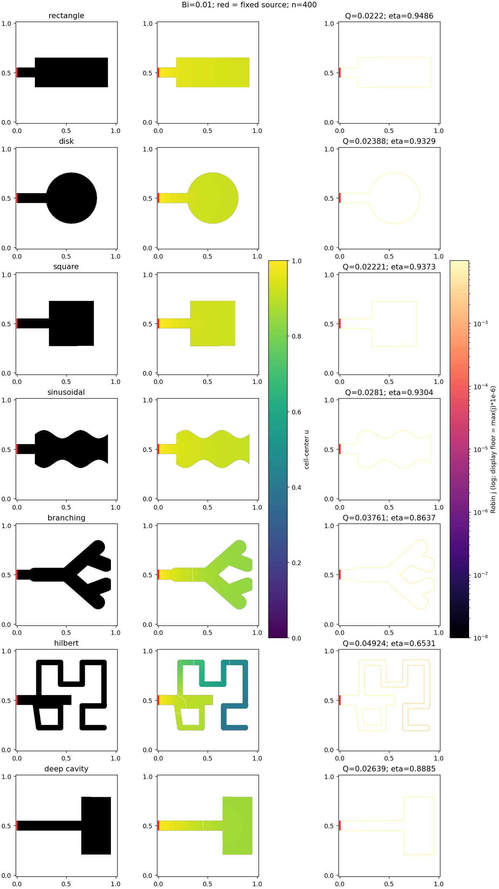

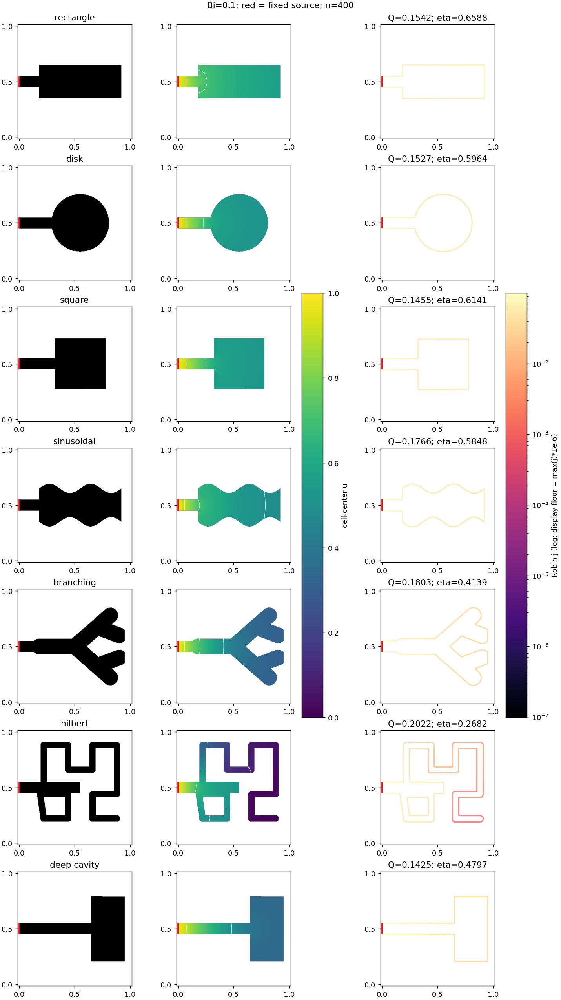

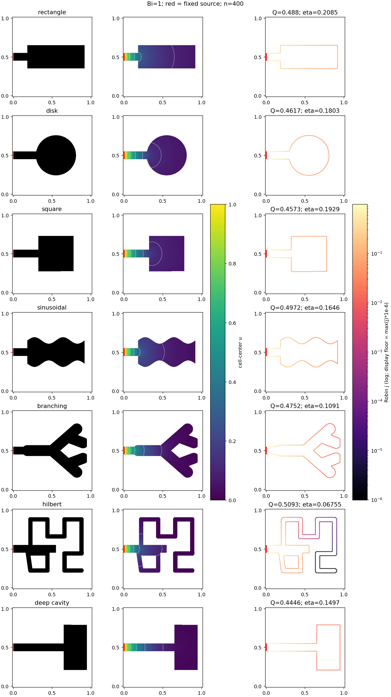

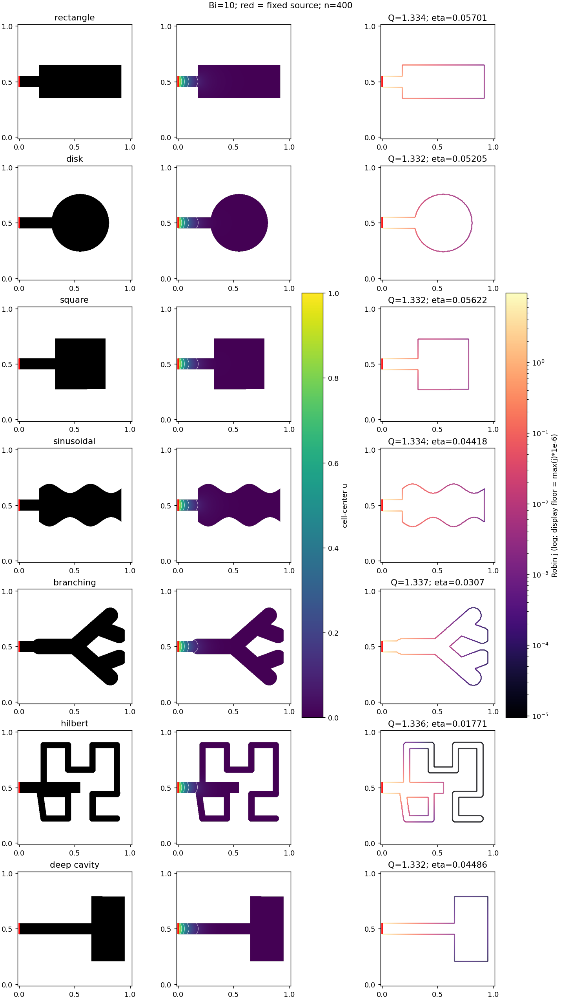

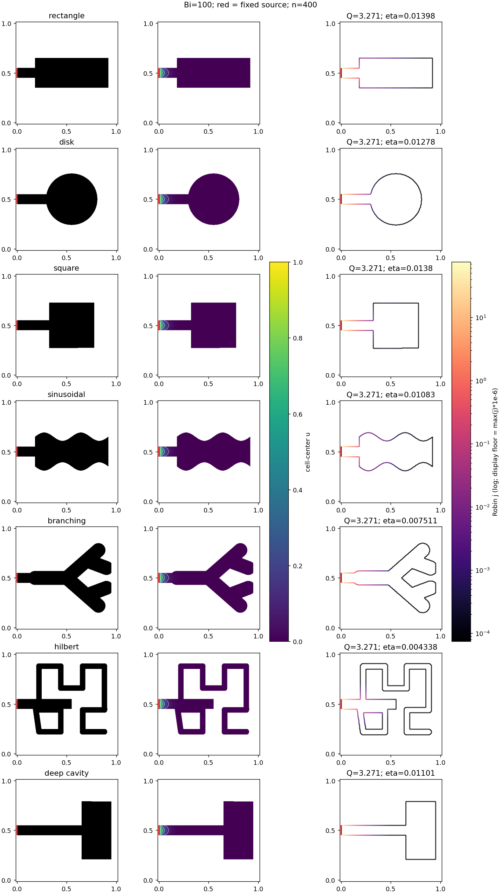

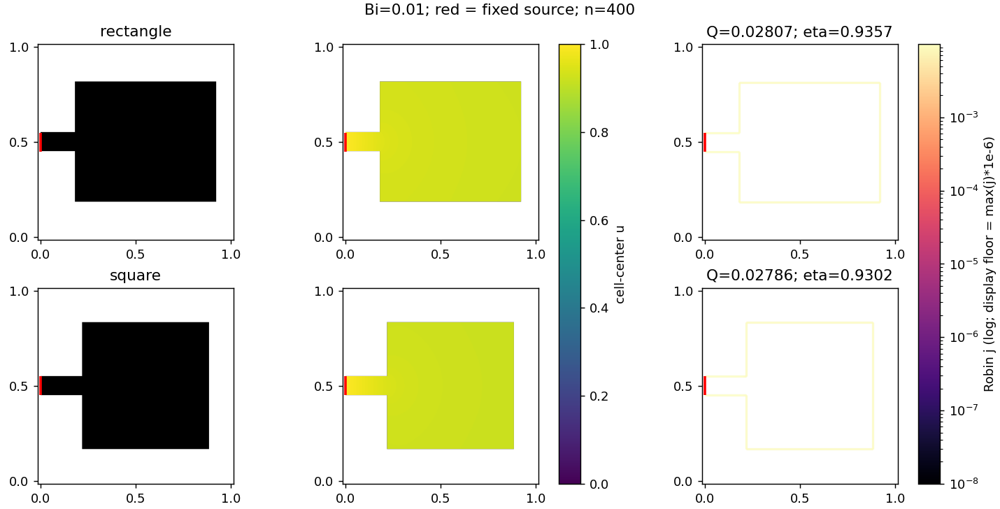

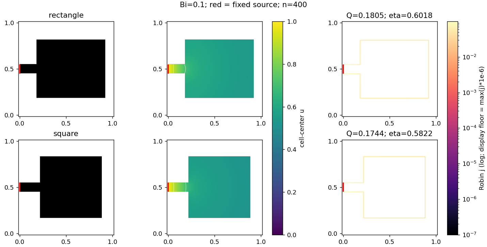

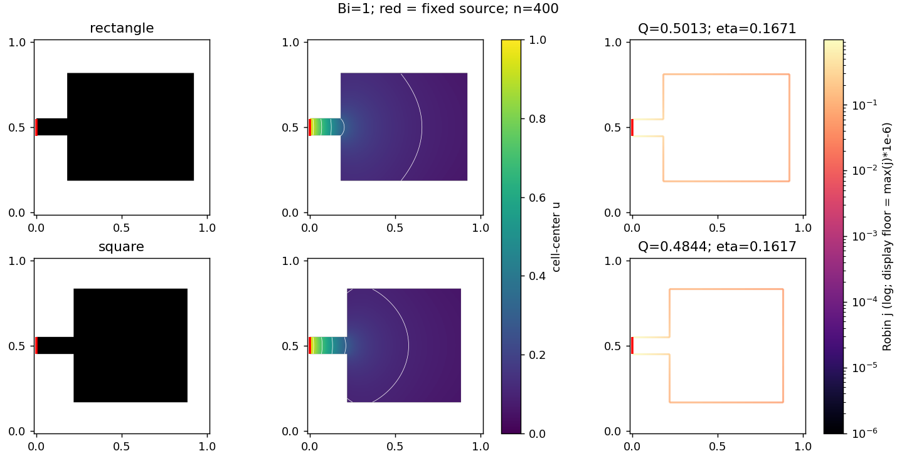

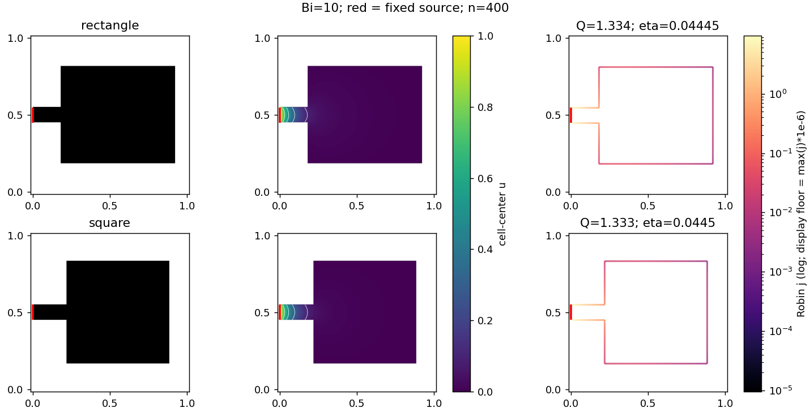


