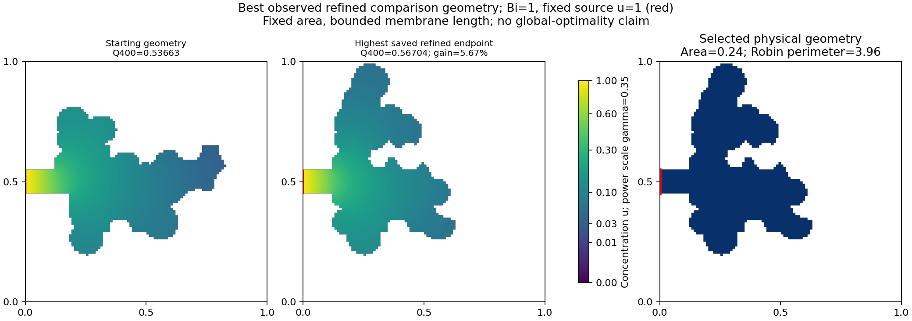

# Best observed refined geometry

## New cap-8 study: best observed contenders, 21 October 2026

The completed [paper review](../experiments/paper_review_20261021/report.md)
checks 285 returned endpoints. Highest nominal fine-FEM Q is 0.581930801
(Q400=0.579831643), from an edited acinar_sacs start under flux annealing,
geometry seed 310101/search seed 320000, 1,025 solves, area 0.24 and membrane
length 7.82. Its FEM gain over its own start is 27.55%, with 30.33% more membrane.
The practical range [0.580117022,0.581930802] overlaps a second greedy endpoint;
a unique highest-flux shape is not established. Family labels identify the start,
not preservation of a natural acinus. The field/redistribution figure is in the
paper review package. This cap-8 result is not directly comparable with the
historical cap-4 ranking below.

## Historical cap-4 review

Among 1078 saved complete endpoints from 11 comparisons with the same recorded Bi=1, n=100 search grid, area 0.24, perimeter cap 4, feature width 0.04 and protected collar 0.12, the highest Q400 is **0.567037493**.

Source job: `test_rectangle_242001_252001_rl_230002`, policy `rl_230002`, rollout seed 252001.
This is one selected geometry from the earlier 24-episode study, not a claim that its policy performs best on average. Selection is post-hoc development analysis.

Q100=0.564416203; Q200=0.566304929; Q400=0.567037493. Area=0.24, Robin perimeter=3.96, source length=0.10, wall utilization eta400=14.32%.
Its own starting geometry has Q400=0.536631373; gain=5.67%.

Fields are saved n=400 solutions with a shared color scale and unchanged normalized source one.
The selected mask passes the original geometry constraints; independently recomputed conservation error is 5.53e-13. This report performs no new PDE solve.

The ranking covers saved grid-refined comparison endpoints. It does not certify a global or continuum optimum, and excludes unrefined training/internal candidates. Maximizing total Q differs from maximizing membrane utilization eta.

Full ranking, copied masks, fields, provenance and input hashes: `20261020T223106280735Z_best_geometry_review_e827c658`.