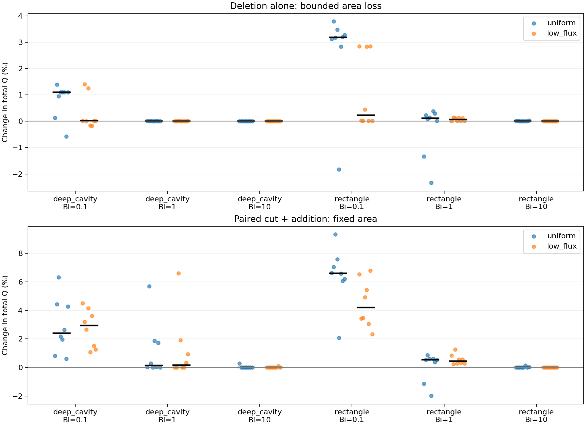

# Controlled low-flux deletion results

Implemented Milestone 4 from AGENTS.md. The experiment asks whether a low-flux
donor is enough to predict that deleting nearby air improves total oxygen flux.
It is not: reproducible low-flux cuts produce both gains and losses.

Run:

```powershell
.\.venv\Scripts\python.exe -m oxygen_shape.cli test-deletions --config configs/deletion_hypothesis.yaml
```

The [complete report](../experiments/20261018T232110846668Z_deletion_hypothesis_2e7be463/report.md)
contains every group, quota, refinement estimate and representative field plot.
The [configuration](../configs/deletion_hypothesis.yaml) fixes seed 7300, the
deep-cavity and rectangle families, Bi=0.1/1/10, eight valid cuts per donor group,
and the 100/200/400 grids. Derived group seeds are recorded per row.

## Outcomes

- All 96 requested cut/addition pairs were sampled in 360 attempts. Evaluating
  each cut alone and its paired reallocation gives 192 candidate evaluations.
- Baseline and selected-example refinement bring the total to 268 PDE solves.
- Of 48 low-flux deletions alone, 37 increase Q, three decrease Q, and eight have
  magnitude below the absolute reporting tolerance of 1e-7.
- Five selected positive and two selected negative low-flux deletion examples
  retain their sign and exceed observed last-grid sensitivity plus tolerance.
- Maximum conservation error over all solves is 4.38e-12 or less.
- Two full successful sweeps have byte-identical metrics.csv files, SHA-256
  `3e965e7e70122ece8bce48c0b8ade74ad0f607d6b6082354fd78e34e256dce9b`.

The sinusoidal initial baseline was excluded because it fails the existing
minimum-feature criterion, including on refined grids. The earlier failed run
is retained. The runner now checks all initial shapes before any PDE solve;
the constraint was not weakened to admit the sinusoidal geometry.

## Supporting example and counterexample

Both examples below remove air next to a donor face in the bottom 20% of eligible
initial j at Bi=0.1, using the same deep-cavity baseline. Initial Q is approximately
0.142559. Here low flux is relative to the eligible wall, not a claim that u=0.

| Cut | Coarse delta Q | Finest delta Q | Last-grid sensitivity | Remaining area | Robin perimeter |
|---|---:|---:|---:|---:|---:|
| low_flux_002_deletion | +0.001998643 | +0.002003839 | 1.469e-6 | 0.2306 | 3.16 |
| low_flux_006_deletion | -0.000240040 | -0.000239567 | 1.343e-7 | 0.2304 | 2.96 |

The second cut raises eta from about 0.478386 to 0.480807 while lowering Q.
This is also a direct example of why maximizing utilization and maximizing
total transfer are different objectives. Both examples are regression-tested
on the 100 and 200 grids; the saved experiment additionally checks the 400 grid.



## Interpretation and limits

Every geometry is evaluated by the full finite-volume PDE. Low-flux donor weights
only generate proposals. The same cut can be useful or harmful depending on how
it changes membrane measure and global access. Adding new Robin cut surfaces
must not be confused with removing an absorbing boundary without replacement.

Deletion alone allows area in [0.228, 0.24); paired edits fix area at 0.24 to
1e-12. Source length 0.1, collar x<0.12, unit footprint, Robin perimeter <=4,
connectivity, hole exclusion and feature width 0.04 are enforced. Both variants
must pass before a cut enters the experiment. Pure-deletion groups do not have
identical removed areas or membrane lengths; the paired protocol supplies the
fixed-area comparison. Unique donor masks avoid duplicated cuts within a group.

Representative examples are selected descriptively from the largest coarse
positive/negative effects. Their refinement is not an independent statistical
test. Eight candidates per group and one seed schedule are exploratory; they
establish counterexamples, not superiority of one donor sampler. Staircase
refinement sensitivity is not a rigorous smooth-domain error bound.

The next milestone is empirical sensitivity-guided search with fresh seeds,
equal total PDE budgets including sensitivity probes, and comparisons against
uniform and flux-based proposal baselines. The existing RL policy stays frozen.
