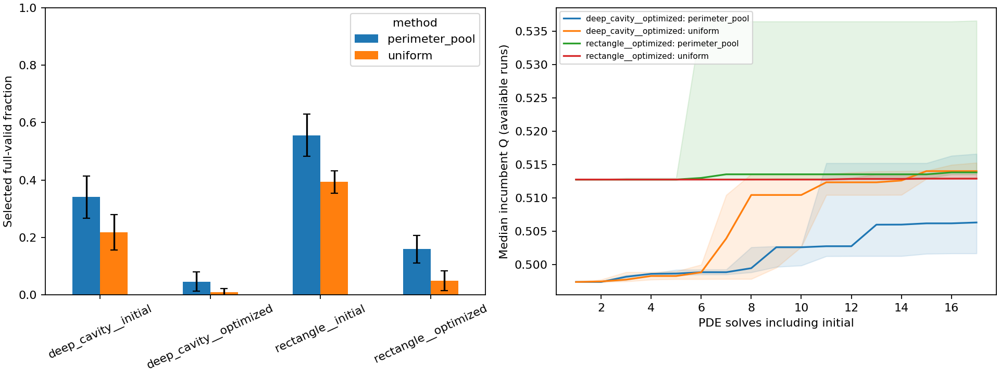

# Geometry-only proposal feasibility results

Completed 2026-10-19. The perimeter-pool prototype and its CLI are implemented.
The fixed study completed all 20 searches and **424 PDE solves** under unchanged
constraints. It runs faster on these two frozen inputs, but does not consistently
improve final flux at equal PDE budgets. It remains an experimental option;
existing default samplers, predictors and the RL checkpoint are unchanged.

## Sources, protocol and artifacts

The supplied papers inform the interpretation of acinar geometry, not the
sampler's claimed performance. [Paper notes](pulmonary_papers.md) distinguish
their structural count/path objectives from our globally solved oxygen flux,
and record coarse-model limitations, unit-extraction pitfalls and a seed-count
arithmetic discrepancy.
No physiological calibration or permeability law was imported.

- [Protocol fixed before collection](feasibility_method.md)
- [Original run report](../experiments/20261019T022143128671Z_proposal_feasibility_1112f734/report.md)
- [Reviewed presentation with variability and explicit ties](../experiments/20261019T022143128671Z_proposal_feasibility_1112f734/reviewed/report.md)
- [Summary](data/feasibility_summary.json), [audit](data/feasibility_audit.csv),
  [search evaluations](data/feasibility_evaluations.csv),
  [histories](data/feasibility_metrics.csv) and
  [input identities](data/feasibility_input_manifest.json)

The original report/figure and all source snapshots remain unchanged. The
reviewed presentation adds SD/IQR summaries and reports ties explicitly without
changing proposals, solves or study settings. Its analysis manifest records
input CSV and renderer hashes. The repository has no Git commit; the run saves
the executed source tree, configuration and environment versions.

```powershell
.\.venv\Scripts\python.exe -m oxygen_shape.cli benchmark-feasibility --config configs/feasibility_benchmark.yaml
```

## What changed

The sampler draws eight ordinary area-balanced disk proposals. With probability
0.25 it uses the first draw unchanged. Otherwise it chooses the lowest-perimeter
candidate passing cheap area, source-collar and perimeter-budget screens, with
random tie selection. If none passes, it uses the first draw. This preserves
uniform exploration support. Every selected candidate still undergoes the full
source, topology, footprint and minimum-feature checks at n=100/200/400 before a
PDE solve. Only a positive global delta-Q above the existing tolerance accepts
an edit. Small perimeter alone never accepts a shape.

Every raw draw counts, including invalid and unselected candidates. The
selection rule and hyperparameters were frozen before inspecting the audit.

## Fixed-geometry feasibility audit

Inputs are the same prespecified uniform seed-8000 optimized deep cavity and
rectangle, plus their initial controls. Bi=1, area=0.24, Robin perimeter<=4,
source/collar, connectivity, no-hole rule, footprint and feature width=0.04
are unchanged. Frozen hashes, metadata and baseline Q were verified before
sampling. Five new seeds 8600-8604 each draw 64 pools per case: **10240 raw edits**.

Each pool compares slot zero with the mixture selector. Full validation of all
eight edits is done for the audit only; its outcomes are unavailable to the
selector. No candidate PDE solves occur in this phase.

| Fixed case | Uniform selected valid / 320 | Pool selected valid / 320 | Uniform valid per charged raw draw | Pool valid per charged raw draw |
|---|---:|---:|---:|---:|
| Deep cavity, initial | 70 (21.9%) | 109 (34.1%) | 21.88% | 4.26% |
| Deep cavity, optimized | 3 (0.94%) | 15 (4.69%) | 0.94% | 0.59% |
| Rectangle, initial | 126 (39.4%) | 178 (55.6%) | 39.38% | 6.95% |
| Rectangle, optimized | 16 (5.00%) | 51 (15.94%) | 5.00% | 1.99% |

Selected yield improves, but yield per charged raw draw decreases in every case.
An eight-draw selection is not one unit of work. The possible runtime benefit
comes from avoiding expensive full checks on seven unselected edits, not from
creating more valid geometries per raw draw. There were no duplicate valid masks
within replicate in this audit. Selected face coverage changes and is recorded
in the complete report; the uniform branch does not guarantee equal finite-sample
coverage. Very few optimized deep-cavity edits are valid, so its yield estimate
is particularly uncertain.

## Equal-PDE-budget search

Five separate seeds 8800-8804 per optimized input use both methods, with order
rotated by seed. Each run spends 17 PDE solves including its own initial solve
and has a strict cap of 6000 raw draws. All runs meet the solve budget. Greedy
acceptance, feasibility checks, effect tolerance and primitive radius distribution
are identical. The population of proposed edits intentionally differs.

| Frozen input | Method | Final Q median [Q1, Q3] | Median eta | Median raw draws | Median selected checks | Median search seconds |
|---|---|---:|---:|---:|---:|---:|
| Deep cavity | Uniform | 0.513989 [0.512847, 0.515248] | 0.129507 | 1252 | 1252 | 8.293 |
| Deep cavity | Perimeter pool | 0.506280 [0.501638, 0.516579] | 0.132675 | 1240 | 155 | 2.643 |
| Rectangle | Uniform | 0.512862 [0.512820, 0.513510] | 0.128846 | 395 | 395 | 3.778 |
| Rectangle | Perimeter pool | 0.513794 [0.513510, 0.536559] | 0.129674 | 1104 | 138 | 2.397 |

The pool wins final Q on 2/5 deep-cavity seeds and 3/5 rectangle seeds, with one
rectangle tie and one loss. The same wins, losses and tie persist at n=400;
differences are classified with absolute tolerance 1e-7. The deep cavity shows
why a higher eta need not mean higher total flux. Median final Robin perimeters
are 3.96/3.88 for uniform/pool on the deep cavity and 3.98/3.96 on the rectangle.

Search time is lower for the pool in all ten pairs. Median paired uniform/pool
time ratios are 2.59 for deep cavity and 1.44 for rectangle. These are medians of
paired ratios, not ratios of median times. Single-machine timings include raw
generation, selection, full validation, PDE solves and candidate storage. They
are exploratory measurements, not a general hardware-independent speedup claim.
The pool spends more raw draws on the rectangle while requiring fewer selected
full checks. A future equal-wall-time comparison would answer a different
question than this equal-PDE-budget experiment.



Bands and error bars summarize variability across five seeds, not confidence
intervals. The two large rectangle gains are visible in the wide upper quartile;
reporting only the median would conceal that variation.

## Numerical and reproducibility checks

The solve count is **4 input checks + 340 search + 80 refinement = 424**.
Runtime for the complete audit/search/report workflow is 283.3 seconds on this
machine. Maximum conservation error is 5.1643e-13. Every saved candidate has
area 0.24 within 1e-12 and Robin perimeter at most 4. Coarse incumbent Q is
nondecreasing, and the final gains relative to frozen inputs are nonnegative at
200/400. One pool rectangle run accepts no changes and has zero gain.

Positive sign persistence alone is not evidence of numerical convergence. For
example, uniform rectangle seed 8803 has gains 8.13e-5, 2.88e-5 and 7.21e-6
at 100/200/400: the remaining gain is smaller than its observed refinement
change. Do not describe that small gain as a resolved continuum improvement.
Refining a staircase also does not remove its orientation bias.

Raw proposal logs record seeds, face pairs, radius, centers, selection mode,
cheap screens and all selected rejection reasons. Every candidate PDE mask,
field and physical metric is retained. Exact solve/raw counts and source/input
checksums were checked after completion; source files are unchanged.

The complete regression suite passes **188 tests**. Seven focused tests passed
again after adding variability/tie presentation; Ruff lint/format checks pass.
These cover incomplete raw budgets, mandatory full validation, uniform support,
global-flux rejection, duplicate caching, replay and end-to-end provenance/costs.

## Interpretation and next experiment

The implementation improves selected feasibility and measured runtime here,
but minimum-perimeter selection sacrifices flux on several seeds. It is not
evidence that RL or sensitivity guidance beats uniform in PDE-solve budget.
One frozen input per family, one Bi and five seeds limit generality; no setting
or model is promoted from these results.

Next, separate cheap feasibility screening from the minimum-perimeter bias:
compare uniform selection among candidates passing the same cheap screens with
minimum-perimeter selection on identical raw pools, retaining the uniform
exploration branch. Freeze the rule before fresh search streams. This tests
whether full-check savings can be retained with less distortion of useful edits.
Only then consider a larger equal-wall-time study or renewed learned guidance.
The supplied papers motivate later acinar geometry families and explicit
wall-coverage studies, with new model validation; they do not justify skipping
the current 2D scientific gates.
