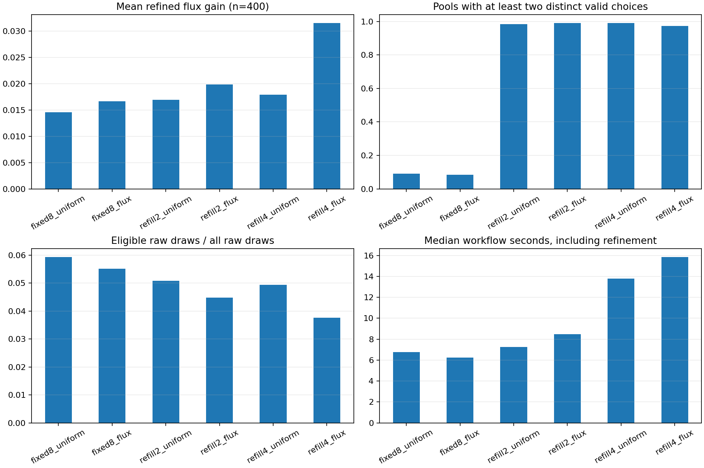
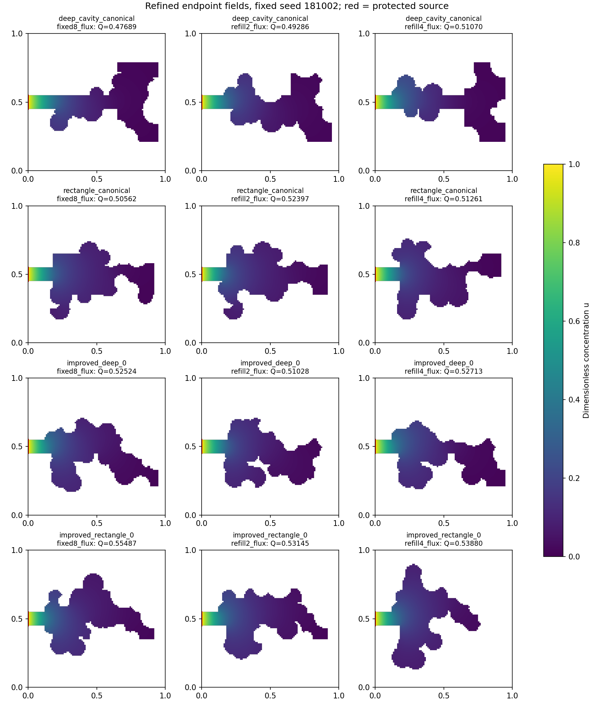

# Distinct valid proposal pools: completed development results

The 180-run comparison is complete, with 180 completed
PDE budgets and 0 raw-budget exhaustions. It tests
candidate availability before further RL training. No policy is trained or
promoted. [Frozen protocol](feasible_pool_method.md);
[original run and exact source snapshot](../experiments/20261019T122613613156Z_feasible_pool_b8b49d2b/summary.json).

Under the fixed PDE budget, four-choice flux ranking beats fixed8 flux on
24/30 matched pairs, with
0 ties and 6
losses. Its median matched workflow-time ratio is 2.40.
On previously improved starts, multiple-choice pool availability rises from
4.1% to
97.8%. This supports the pool
mechanism, but does not demonstrate an equal-time or learned-policy advantage.

The user-shared PINN topology post motivated explicit constraint attack tests
and independent physical verification. Its Re=30/Stokes and mathematical
optimality claims need evidence; collapsing or displaced material can expose a
missing admissibility condition. See the
[critique and primary references](pinn_topology_critique.md).

A turn interruption stopped execution after 97 completed jobs. Their summary and final-mask files were hash-verified unchanged; only unfinished work was restarted with the same frozen algorithms. Interrupted overhead is 5--6 additional PDE solves: one in-flight completion cannot be determined exactly. The partial artifacts and accounting are retained in recovery.json and interrupted_attempts/. This overhead is separate from the completed matrix totals below.

Finalization identified an all-zero derived refinement CSV and completion log
in the last pre-interruption job. Their original bytes are archived. The table
was rebuilt from independently checked saved concentration fields and boundary
fluxes; summaries, masks and numerical arrays were unchanged, with no new PDE
solve. [Repair record](../experiments/20261019T122613613156Z_feasible_pool_b8b49d2b/artifact_repairs/repair.json).
The audit separately records 2
unreadable candidate archives in the discarded interrupted attempt; they were
never used in the completed comparison. All completed-matrix fields pass.

## Design and interpretation

Six known development starts: canonical deep cavity and rectangle, plus two
previously improved masks of each family. Their former test role ended before
this study; they are now development knowledge. Five fresh seeds per start,
six methods, Bi=1, n=100 and independently solved endpoints at n=200/400.
Area 0.24 +/- 1e-12; Robin perimeter <=4; source length 0.1 and protected collar
0.12; connected air region; no holes; operational feature width 0.04 checked at
all three resolutions. The feature criterion is a raster morphological test,
not an exact continuum minimum-neck certificate.

Fixed pools contain eight raw draws. Refill seeks two/four distinct eligible
edits after at least eight draws, capped at 256 draws per pool. All methods
retain probability 0.25 on the first unconditional raw proposal; otherwise
select uniformly or by incumbent-wall-flux score. No candidate PDE informs the
ranking. Only a fully valid candidate can be solved, and only actual global
coarse Q improvement >1e-7 accepts an edit. Every raw draw and full geometry
check is charged. All runs have a 17-PDE upper budget and 6000-raw-draw cap;
endpoint refinement adds four solves. Refill is rejection sampling, not a
learned improvement of raw proposal quality. [Capacity calculation](valid_pool_capacity.md).

## Outcomes under the fixed PDE/raw budgets

These are equally weighted per-run means and medians. Workflow seconds include
candidate artifact storage and endpoint refinement; they exclude any training
because there is none. Timing is descriptive and is not an equal-wall-time test.

| Method | Completed / 30 | Mean fine gain Q | Multiple-choice pools | Eligible raw fraction | Median seconds |
|---|---|---|---|---|---|
| fixed8_uniform | 30/30 | 0.014554 | 9.1% | 5.93% | 6.77 |
| fixed8_flux | 30/30 | 0.016663 | 8.4% | 5.51% | 6.24 |
| refill2_uniform | 30/30 | 0.016926 | 98.4% | 5.08% | 7.26 |
| refill2_flux | 30/30 | 0.019830 | 99.0% | 4.48% | 8.50 |
| refill4_uniform | 30/30 | 0.017899 | 99.1% | 4.94% | 13.81 |
| refill4_flux | 30/30 | 0.031542 | 97.2% | 3.76% | 15.86 |

Physical transfer and membrane utilization are reported separately. Refinement
keeps the same raster cell union and Robin boundary measure, so fine eta is
Q_400 / (Bi * Robin perimeter). Mean eta is the mean of these per-run ratios.
Maximizing Q and maximizing eta remain different objectives.

| Method | Mean final Q at n=400 | Mean ideal Q | Mean fine eta | Mean Robin perimeter |
|---|---|---|---|---|
| fixed8_uniform | 0.514156 | 3.920000 | 0.131184 | 3.9200 |
| fixed8_flux | 0.516265 | 3.930000 | 0.131382 | 3.9300 |
| refill2_uniform | 0.516528 | 3.915333 | 0.132030 | 3.9153 |
| refill2_flux | 0.519433 | 3.922667 | 0.132437 | 3.9227 |
| refill4_uniform | 0.517501 | 3.916000 | 0.132185 | 3.9160 |
| refill4_flux | 0.531144 | 3.924000 | 0.135423 | 3.9240 |

Greater multiple-choice availability is a mechanism result, not proof of better
raw yield, learned decision quality, computational speed or global optimality.
Raw eligibility additionally excludes incumbent, duplicate and already-solved
masks. State trajectories differ, so its changes do not isolate a causal change
in the ordinary disk primitive's feasibility.

## Starting-shape strata

Canonical and previously improved shapes have different remaining headroom.
The descriptive split prevents large canonical gains from hiding harder cases.

| Starting group | Method | Runs | Mean fine gain Q | Multiple-choice pools | Median seconds |
|---|---|---|---|---|---|
| canonical | fixed8_flux | 10 | 0.028583 | 17.0% | 9.00 |
| canonical | fixed8_uniform | 10 | 0.027389 | 20.8% | 8.47 |
| canonical | refill2_flux | 10 | 0.038143 | 98.1% | 10.07 |
| canonical | refill2_uniform | 10 | 0.032020 | 97.1% | 11.49 |
| canonical | refill4_flux | 10 | 0.060929 | 96.0% | 17.25 |
| canonical | refill4_uniform | 10 | 0.033784 | 98.7% | 16.22 |
| improved | fixed8_flux | 20 | 0.010703 | 4.1% | 4.56 |
| improved | fixed8_uniform | 20 | 0.008136 | 3.3% | 4.44 |
| improved | refill2_flux | 20 | 0.010674 | 99.4% | 6.35 |
| improved | refill2_uniform | 20 | 0.009379 | 99.1% | 6.54 |
| improved | refill4_flux | 20 | 0.016848 | 97.8% | 11.25 |
| improved | refill4_uniform | 20 | 0.009957 | 99.3% | 9.95 |

## Matched comparisons

Each refill method is compared with the fixed8 control using the same starting
mask, seed and ranker. Fine Q at n=400 defines a win/loss with tolerance 1e-7.
All outcomes, including budget exhaustion, are retained. Controls are reused
across the two quota comparisons; these counts are not independent replicates.

| Refill vs fixed8, same ranker | Wins | Ties | Losses | Mean fine delta Q | Median time ratio |
|---|---|---|---|---|---|
| refill2_flux | 19 | 0 | 11 | 0.003168 | 1.40 |
| refill2_uniform | 17 | 0 | 13 | 0.002372 | 1.39 |
| refill4_flux | 24 | 0 | 6 | 0.014879 | 2.40 |
| refill4_uniform | 19 | 0 | 11 | 0.003346 | 2.19 |

Within a quota, comparing the flux heuristic with a uniform ranker measures
whether a particular simple ranking can use the alternatives. It does not
establish that the current learned policy could do so.

| Flux vs uniform | Wins | Ties | Losses | Identical final masks |
|---|---|---|---|---|
| fixed8 | 11 | 12 | 7 | 12 |
| refill2 | 16 | 0 | 14 | 0 |
| refill4 | 26 | 0 | 4 | 0 |

Fields use the middle rollout seed 181002 and the first improved start in each
family, selected by a descriptive display rule rather than the best outcome.
Only the flux-ranked methods are shown; complete uniform outcomes are retained
in the data. White is outside the domain; red is the protected source.

## Numerical and reproducibility audit

- 179/180 fine gains are positive; minimum
  0. In
  179/180 runs the fine gain
  exceeds the observed change in gain between n=200 and n=400. This observation
  is a refinement diagnostic, not a rigorous continuum error bound.
- 3780 new experimental PDE solves, zero training
  solves; historical preparation of reused masks belongs to the earlier study.
  Total raw draws 243686; full candidate geometry checks
  45924; accepted edits 1397.
- Maximum recorded conservation error 6.021e-13.
  The separate audit recomputes every saved field's face fluxes and cell balance
  using vectorized differences without a linear solve: 3780
  fields, maximum recomputed conservation error
  6.028e-13. It replays all
  2880 selected valid disk edits from their seeds
  and verifies exact candidate masks, hard constraints and global acceptance.
- Exact source files, input checksums, configuration, software versions, raw
  proposal seeds and selection probabilities are retained. The source audit
  passes. Git commit is null because this repository has no first commit.
  Recorded completed workflow durations sum to 1786.3
  seconds, excluding interrupted work, downtime, setup, regression tests and
  subsequent audit/report generation.
- Regression gate: 217 tests pass. Ruff checks and formatting pass. New attack
  tests reject collapse, isolated islands, spatial evasion, source changes and
  Robin-to-Neumann relabeling. Existing edits already preserve boundary labels;
  there is no evidence earlier optimizers exploited relabeling.

## Consequences and next work

Retain the finite-volume reference and current hard constraints. This mechanism
study does not establish a reliable RL advantage or select a production default.
The next comparison should address useful choices per unit cost: feasibility-aware
location/radius proposals, followed by learned-versus-untrained/flux selection
with all generation and training costs counted. Fresh final-test geometries
must be reserved before that comparison; these six starts are development data.
An equal-wall-time comparison, transfer across Bi and richer observations remain
open. Monte Carlo and 3D gates are unchanged.

[GPU availability and measured CPU phases](gpu_readiness.md) records the verified
RTX 4060 Laptop GPU and why this small linear selector remains on the CPU.

## Portable data

[Run totals](data/feasible_pool_summary.json),
[all 180 outcomes](data/feasible_pool_evaluations.csv),
[method summaries](data/feasible_pool_method_summary.csv),
[starting-group summaries](data/feasible_pool_stratum_summary.csv),
[quota pairs](data/feasible_pool_paired_comparisons.csv),
[ranking pairs](data/feasible_pool_ranking_comparisons.csv),
[artifact audit](data/feasible_pool_artifact_audit.json),
[descriptive analysis](data/feasible_pool_descriptive_analysis.json).
