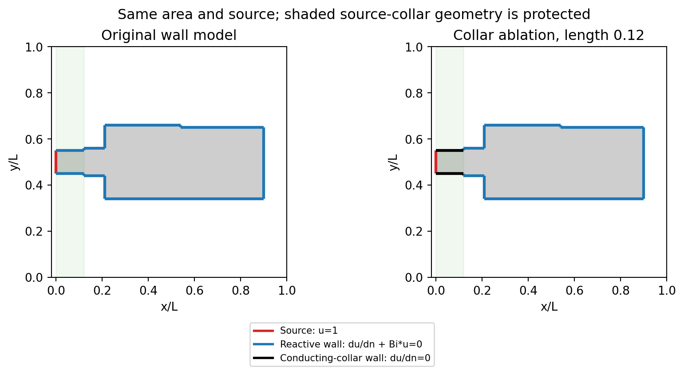
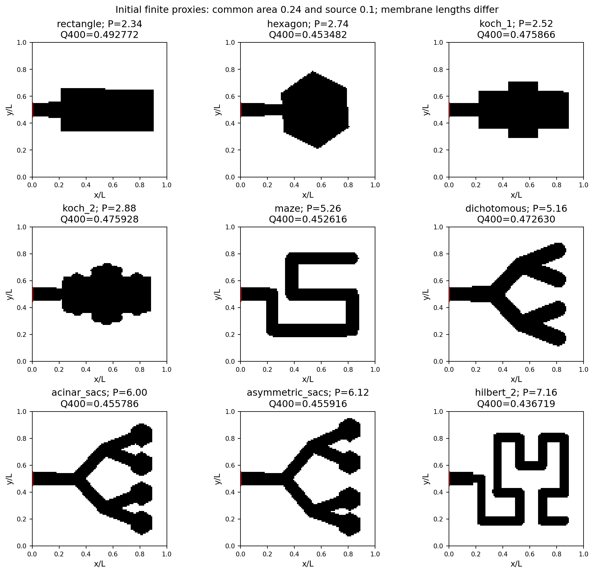
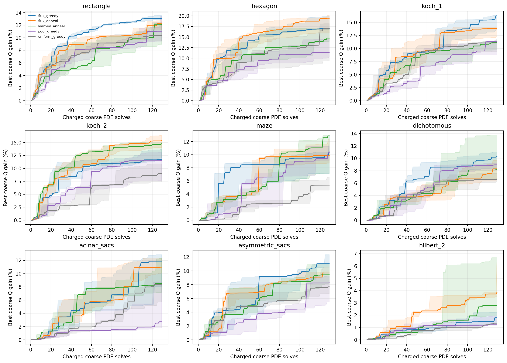
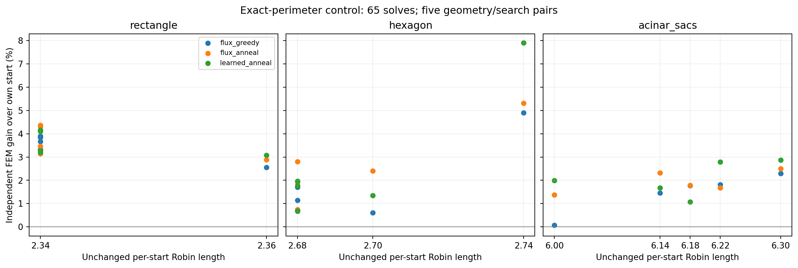
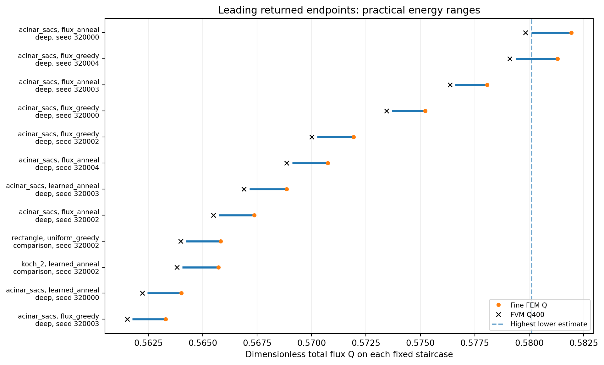
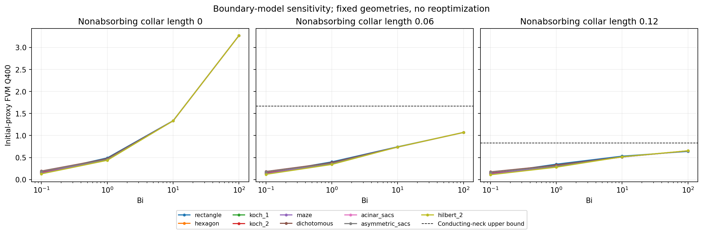
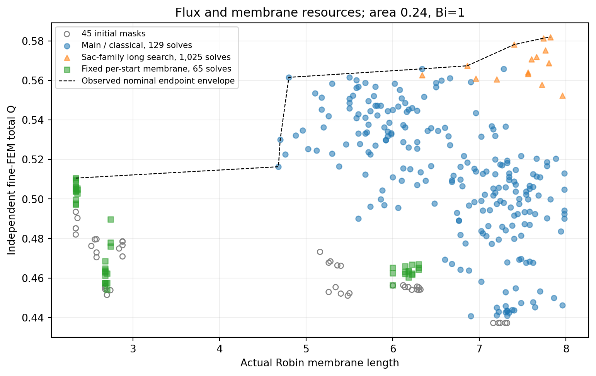

# Constrained geometry search for steady Robin diffusion: accessibility, membrane resources and numerical representation

**Nabil ES-SAADI**

Independent researcher

Computational manuscript draft for human review, 21 October 2026. All numerical
studies, added conventional controls and independent numerical checks reported here are
complete. Tables, figures and technical supplements accompany the local evidence.
This draft has not been submitted or independently reviewed by human authors.

## Abstract

Geometric complexity can increase reactive membrane length while reducing
diffusive accessibility. We study this competition in a controlled
two-dimensional Laplace problem with a fixed concentration source and Robin
walls. Nine finite geometry families span simple chambers, prefractal profiles,
branching sac proxies and tortuous paths. Area, source and permitted footprint
are shared, with a membrane-length cap and operational feature checks. Five
search methods compare uniform, flux-guided, paid-pool and response-regression
selection under equal PDE budgets on 45 development starts. Separate long
trajectories and exact-perimeter controls distinguish search horizon and resource
constraints. Independent finite elements and complementary energy estimates
check 285 returned endpoints; 284 show numerically separated improvement over
their starts. Flux guidance improves average outcomes relative to the added
uniform and paid-pool controls, whereas the tested response ranker does not
improve on flux guidance. The leading long-search endpoint gains 27.55% in FEM
flux while adding 30.33% membrane; utilization falls, and two leading designs
remain numerically unresolved. A conducting-collar ablation changes total flux
and geometry spread, while an analytical strip rules out a universal finite
high-permeability plateau when ideal source and sink walls touch. These findings
support a reproducible finite-design benchmark and qualify interpretations based
on complexity or natural resemblance. They do not establish optimal natural
acini, a globally optimal shape or general reinforcement-learning superiority.

## Introduction

An absorbing surface may be geometrically large while only a fraction of it
receives substantial diffusive supply. Pulmonary transport motivates studying
this distinction, but an anatomical explanation requires more than optimizing
the outline of a planar chamber. Screening depends on diffusivity, permeability,
access paths and resource constraints. Sapoval, Filoche and Weibel relate
pulmonary screening to a characteristic diffusion-to-permeability length [1].
Finite irregular surfaces also illustrate how added geometric complexity and
reactive activity interact [2]. Space-filling transport models [3] and polyhedral
acinus generators [4] motivate geometric controls without establishing that
any particular planar proxy is a physiological optimum.

We ask a narrower question: for a fixed source, area, permitted bounding box and membrane
budget, which admissible finite geometries achieve greater total steady
absorption? We also ask whether predicting measured global responses makes
local search more effective than a cheap flux heuristic. The physical objective
is total transfer, rather than membrane utilization alone. The comparison must
allow simple controls to outperform nature-inspired proxies and learned methods
to lose against conventional search.

The governing design idea has substantial prior work. Marck, Nadin and Privat
study inlet-flux maximization for fins with volume and surface constraints [10].
Their conclusion explicitly discusses a multidimensional Laplace problem with
a held-temperature inlet and Robin lateral exchange. The PDE and flux objective
used here are therefore not proposed as new. Their nonexistence results concern
a reduced one-dimensional design class; they do not establish nonexistence or
optimality for our finite raster problem. Reduced cooling-fin analysis also
examines the balance of conduction and surface resistance [11], under assumptions
that do not prescribe an optimal Bi for arbitrary planar air domains.

Other related formulations help delimit the comparison. Nicolaou and Mulder
optimize reactivity on fixed exterior bodies [5]; here the interior air domain
changes and reactivity is uniform and fixed. Thermal insulation optimization
uses related Robin energies while minimizing heat loss with a different source
and admissible set [13]. Tree structures can lose to simpler structures for
specified heat-conduction objectives [12], but that result does not identify
the winner for our absorption objective. Convection-coupled fin optimization
also demonstrates the role of spacing and entrance constraints [14]; its
governing transport and design variables differ from ours.
Free-boundary Robin energy minimization also has established relaxation and
existence theory [15]; these results cannot be imported as a maximization or
continuum-optimality theorem for the present finite design class.

Oxygen-transfer shape optimization itself also has prior numerical examples:
Pearce et al. optimize an axisymmetric placental capillary dilation using FEM
and sequential quadratic programming with pressure-driven blood flow [16].
Learned thermal design is established as well: PPO with body-fitted CFD and
Bezier boundaries has been used for heat-exchanger shape optimization [17],
and cooperative deep RL with a pretrained surrogate for fin design [18].
These objectives and parameterizations differ from the present interior
Robin-diffusion benchmark. Our online linear response ranker is neither PPO
nor a deep generative policy, and no first-use claim for learning is intended.

The candidate contribution is a reproducible finite-geometry comparison that
connects paid search performance, practical numerical ranking uncertainty,
membrane resources and inlet-wall assumptions. Neither nature-inspired shapes,
standard search controls nor functional error estimates are claimed as new.
The related-work assessment is targeted rather than systematic, and the
empirical contribution still requires independent subject review.

## Model and admissible geometry

Let u=(C-C_b)/(C_0-C_b), with coordinates scaled by a fixed length L. We solve

    Laplacian(u)=0 in Omega,
    u=1 on Gamma_D,
    du/dn+Bi*u=0 on Gamma_R,
    du/dn=0 on optional Gamma_N,
    Bi=W*L/D.

The objective is Q=integral_Gamma_R Bi*u ds. We also report
eta=Q/(Bi*P_R), where P_R is reactive membrane length. Eta is diagnostic and
does not determine training labels or acceptance. Physical two-dimensional
flux per unit out-of-plane depth is D*(C_0-C_b)*Q. Scaling source amplitude
therefore changes dimensional flux but not normalized fields or shape rankings
in this linear model.

For a fixed domain and boundary partition, Q(Bi) is the minimum of energies
affine in Bi, so it is nondecreasing and concave. The envelope identity is
dQ/dBi=integral_R u^2; eta is nonincreasing, and tends to one only in the
fixed-domain Bi-to-zero limit. All 27 saved geometry/grid sweep curves satisfy
the associated discrete secant and utilization checks. The derivation and
analytical slab check are provided in permeability_response.md; these are
standard variational consequences rather than new shape-optimization theorems.

The primary search uses Bi=1, a unit bounding square, area 0.24, source length
0.1 at x=0, y in [0.45,0.55], and P_R<=8. Source-collar geometry at x<0.12
is protected. Domains must be source-connected and have no internal holes.
Area is preserved exactly in cell count. The box is an allowed region, not a
matched occupied diameter or a requirement to supply a whole tissue territory;
search can move area toward the source. Different initial families have
different actual membrane lengths; the common cap does not match those lengths.
Separate controls preserve each start's perimeter exactly, without imposing
one shared perimeter across families.

The operational feature rule uses disk opening with radius 0.02. The opened
core must be connected and intersect the source; every interior pixel must be
within 0.01+sqrt(2)*h of it. The rule is checked on n=100 and physical subdivisions
to n=200 and n=400. It permits short boundary bumps and is not a strict pointwise
minimum-width or curvature constraint. This distinction limits continuum and
biological interpretations of pixel-scale edited endpoints.

Figure 1. Source and reactive-wall labels on the same representative geometry. The optional collar changes only proximal boundary conditions; distal wall remains reactive. Shading marks protected geometry.

## Geometric controls and evaluation design

The nine deterministic generator families are rectangle, hexagonal chamber,
square-Koch level 1, regularized square-Koch level 2, serpentine maze,
two-generation dichotomous branches, terminal hexagonal sacs, asymmetric sacs
and a finite Hilbert-order-2 path. These are finite controls, not reconstructions
of published three-dimensional meshes. The level-2 raster profile uses declared
signed-distance smoothing length 0.012 to avoid unresolvable contacts.

Family names identify the starting generator. Subsequent edits can erase its
characteristic branches or cavities; an endpoint label does not establish that
the shape still belongs to an anatomical or prefractal family.

Seven training masks exclude maze and Hilbert families. The evaluation bank
contains 45 distinct masks, five per family, and zero training-mask overlap.
Generator retries depend only on validity and identity, before PDE outcomes;
all retries and parameters are retained. Distinct masks are not independent
anatomical observations. Earlier model development, including earlier RL
failures and a seed-0 implementation profile, informed the frozen protocol.
This study remains exploratory development evidence rather than a final
confirmatory cohort.

The main comparison comprises 9 families x 5 paired geometry/search seeds x
3 methods, each with 129 solves. A predeclared sac-family study allows 1,025
solves per trajectory. Exact-perimeter controls use rectangle, hexagon and sacs,
five seeds, three methods and 65 solves. The different long-horizon budget must
not be used as evidence for sac-family superiority over shorter searches.

After observing the main comparison, two missing conventional controls were
specified on the same 45 development starts: uniform eligible selection with
greedy acceptance, and fully evaluated-pool greedy search. This extension is
declared post hoc and cannot create a fresh confirmatory cohort. Each new
trajectory has the same 129-solve limit. Imported original results and fields
are hashed and reused; the original study is not changed retrospectively.

Figure 2. Initial finite geometry proxies at Bi=1. Area and source are shared; actual membrane lengths differ. Names identify generators, not anatomical reconstructions.

## Numerical methods and validation

A cell-centered Cartesian finite-volume solver assembles conserved face fluxes.
Interior conductance is one, the half-cell source conductance is two, and a
Robin face has conductance Bi*h/(1+Bi*h/2). The same conductances compute
source influx and reactive absorption. Direct sparse solves must satisfy
residual, maximum-principle and conservation tolerances. Analytical slab,
zero-permeability, symmetry and refinement tests precede optimization.

Every returned endpoint and its start is checked at n=200/400 and with an
independently assembled continuous P1 triangular finite-element solver at
maximum areas 8e-5 and 2e-5. Its consistent Robin edge matrix is
Bi*l/6 times [[2,1],[1,2]]. These calculations share the physical staircase
boundary but not the finite-volume assembly. Separate physical polygons
quantify the additional effect of rasterizing oblique walls.

On a fixed polygon, the solution minimizes E(v)=integral |grad v|^2 plus
Bi*integral_R v^2, with source trace one; E(u)=Q. The conforming FEM energy
provides an upper estimate. A normal-continuous Raviart--Thomas reconstruction
from finite-volume face fluxes supplies a complementary lower estimate, with
an explicit divergence-residual correction. These are applications of established
functional error-estimation ideas [6], with this Robin expression derived in
complementary_flux_bounds.md. Practical floating guards are reported; these
are not interval-arithmetic certificates or corrections of geometry bias.

The source-corner model is checked independently by separation of variables
in a rectangle with reactive lateral walls, full inlet Dirichlet data and a
Neumann end. A positive eigenfunction series gives flux with a bounded truncation
tail. Its Bi-to-infinity limit diverges when perfect source and sink boundaries
touch; a finite plateau is therefore not generally applicable to this boundary
partition. Finite Bi remains well posed. Related Robin corner analysis is
established [7,8]. A separate fixed-geometry ablation inserts nonabsorbing
proximal collars of length 0.06 or 0.12; these lengths are model hypotheses,
not anatomical measurements. Distal walls remain reactive.

## Search and measured-response learning

Each proposal uses paired disk redistribution with probability 0.75 or a
perimeter-preserving one-cell exchange with probability 0.25. Every candidate
undergoes the same geometry checks. A pool draws at least four proposals and
refills until at least two valid choices are available, or 96 raw draws are
charged. Ineligible proposals cannot be selected.
The selected geometry is solved and its signed global delta Q is measured.
No local concentration threshold removes material automatically.

Disk radii range from 0.03 to 0.075; the cell-exchange half-width is h/2.
Every trajectory has a maximum of 500,000 raw proposal draws in addition to
its charged PDE limit. Full geometry checks and rejected draws are recorded,
so equal PDE budgets are not described as equal total computation. The frozen
configuration and complete feature definitions are supplied with the code.

The controls select by a fixed local-flux heuristic. Greedy search accepts
delta Q>1e-7. Heuristic annealing can accept decreases with probability
exp(delta Q/(Q_initial*T)), with T decreasing from 0.003 to 0.00002.
The asymmetric proposal does not define an equilibrium sampler. Current and
best states are separate, with restarts to the saved best every 256 solves.

The learned variant uses recursive ridge regression of 100*delta Q/Q_initial
with 28 incumbent/candidate features, a fixed flux prior and source-path
distances. Warm training costs 455 solves and 448 updates across seven families.
Each evaluation restores the same warm parameters and adapts online from its
own measured selected responses. Unselected actions do not receive fictitious
labels. This is response-guided search, not a new deep-RL value function.
Selection adds a ridge-leverage exploration bonus
0.03*sqrt(x_transpose*A_inverse*x) to the predicted response. This is a
heuristic exploration term, not a calibrated statistical confidence interval.
All methods share admissibility, raw primitives and PDE budgets, with 0.20
eligible exploration. Forty-five four-candidate pools are fully evaluated for
ranking diagnosis and charged separately; these labels do not train the model.

In the added uniform control, one eligible candidate is selected without a
flux or learned ranking. In the paid-pool control, eligible candidates are
evaluated in randomized order and every solve is charged. Observed improvements
are accepted as they arrive; the remaining candidates still refer to the fixed
original pool. The final pool can be truncated by the remaining solve budget,
with both available and evaluated counts retained. Neither control uses warm
training, annealing or a free oracle. Interrupted batches retain their pending
candidate masks and random-generator state. Tests distinguish committed solves
from the possible single uncommitted solve interrupted before an atomic save.

Primary comparisons are paired differences in endpoint Q400 at equal coarse
solve budgets, with independent FEM differences and flux intervals providing
numerical checks. Report family-specific distributions, actual perimeter,
draws, checks, runtime and truncated runs. Five variants and a shared training
model do not support population claims about all acini. Plot bands show
interquartile variation, not confidence intervals.

The five combinations per family pair one search seed with one generated
geometry variant; they are not a fully crossed replicate design. Consequently
geometry and search-seed variance cannot be separately estimated. Only one
warm-training sequence is used, so training-replica variability is not measured.
These methods compare selection within the declared discrete edit space; the
study does not benchmark continuum adjoint optimizers or modern deep-RL
architectures, and its outcome is not a general verdict on those methods.

## Initial geometry and permeability

At Bi=1 the representative rectangle gives Q400=0.492772 with P_R=2.34,
whereas the sac proxy gives Q400=0.455786 with P_R=6.00. A finite Hilbert-like
path gives Q400=0.436719 with P_R=7.16. These are unoptimized representatives
under a shared area and perimeter cap; membrane lengths differ. They demonstrate
that extra membrane or anatomical resemblance alone does not ensure greater
total transfer in this model.

The small-permeability limit must be distinguished from simply labeling all
Bi<1 cases membrane limited. For a fixed finite domain, u tends to one and
Q/(Bi*P_R) tends to one as Bi tends to zero. The rate depends on geometry and
source access; the bank does not match P_R. At Bi=0.01, eta400 is 0.949 for
the representative rectangle but 0.525 for the Hilbert-like path. Thus this
particular Bi is not a uniformly well-supplied regime for every tested shape.
A bounding-box-based Bi alone does not remove access-path resistance.

At Bi=100 the spread across initial-family Q400 is 0.0144%, while the largest
n200-to-n400 change is 2.148%. Those small differences cannot be interpreted
as numerically resolved family superiority from grid changes alone. Protected
inlet corners and the spatial onset of absorption require separate examination.

Physical-polygon checks show that staircase agreement cannot substitute for
geometry validation. For the declared hexagonal control, reactive perimeter
changes from 2.20235 in the polygon to 2.58 in its n=400 raster approximation,
while Q differs by about 0.615%. This polygon is a separate physical control,
not the geometry-bank hexagon. Solver and geometry questions must remain distinct.

## Equal-budget search performance

All 135 main searches complete their 129-solve budgets and independent numerical
checks. Against greedy flux guidance, annealed flux guidance wins 23 of 45 paired
Q400 comparisons and loses 22; mean delta Q400 is +0.000208828. The response-guided
annealing variant wins 19 and loses 26, with mean delta Q400=-0.004141622 and
median delta=-0.003490046. Fine-FEM comparisons give 23/22 for fixed-flux
annealing and 18/27 for learned annealing, with mean deltas +0.000223745 and
-0.004191418 respectively. These win counts use the predeclared descriptive
1e-7 threshold; the practical numerical ranges leave close pairs unresolved,
as reported below. These results do not establish a dependable overall
learning advantage for the tested model.

All 90 added conventional-control searches also complete their 129-solve
budgets and independent endpoint checks. Uniform greedy wins seven and loses
38 nominal Q400 comparisons against greedy flux; paid-pool greedy wins 13 and
loses 32. The resulting complete five-method comparison is:

| Method | Nominal Q400 wins/losses vs greedy flux | Mean delta FEM Q | Separated win / overlap / loss |
|---|---:|---:|---:|
| Uniform greedy | 7 / 38 | -0.014903 | 6 / 2 / 37 |
| Paid-pool greedy | 13 / 32 | -0.013043 | 12 / 3 / 30 |
| Greedy flux reference | 0 / 0 (45 self-ties) | 0 | 0 / 45 / 0 |
| Annealed flux | 23 / 22 | +0.000224 | 23 / 1 / 21 |
| Learned annealing | 19 / 26 | -0.004191 | 18 / 1 / 26 |

The added methods have median FEM gains of 8.16% (uniform) and 9.53%
(paid-pool), versus 12.31% for greedy flux. This describes the tested development
bank, not statistical or population-level superiority. A uniform trajectory
nevertheless returns the highest nominal equal-budget FEM endpoint, Q=0.565826;
a single best run does not establish the strongest average policy. The added
controls are a declared post-hoc extension on known masks, not a fresh final test.

Median independently checked gains over each method's own initial geometry
vary by family. Greedy-flux median gains range from 1.80% for Hilbert-like starts
to 17.49% for hexagonal starts. Such gains may include added membrane within the
common cap; they do not isolate accessibility at fixed membrane length.
The fixed-perimeter controls and long trajectories must be reported separately.

The separate warm-model ranking diagnosis uses 45 four-choice pools at the
initial evaluation geometries, spending 180 candidate solves. Mean regret
relative to the best evaluated member is 0.000383626 for learned ranking and
0.000569274 for the fixed-flux heuristic. With a descriptive 1e-12 equality
tolerance they select a best member in 26 and 20 pools, respectively. Very small
responses are not asserted to be continuum-resolved improvements. These
one-step initial-state diagnostics do not predict long-trajectory success:
they use the warm ranker without its leverage bonus or random exploration,
whereas trajectories also adapt to selected outcomes.
The poorer aggregate learned endpoint result remains part of the finding.

Figure 3. Corrected five-method coarse-flux trajectories at 129 charged solves. Lines are medians and bands interquartile ranges over five geometry/search pairs per family, not confidence intervals. Added controls use known development starts.

## Long trajectories, fixed membrane and numerical ranking

All original 195 trajectories complete their declared solve budgets, with no
recorded interruptions. The five 1,025-solve sac-family trajectories per method
have median FEM gains of 25.99% for greedy flux, 25.69% for annealed flux and
23.51% for learned annealing. Learned annealing wins one of five paired Q400
comparisons against greedy flux and loses four, with mean delta Q400=-0.010011.
The separate long horizon does not establish sac-family superiority against
other families that received only 129 solves.

At exactly unchanged per-start membrane length, the 65-solve control has
median FEM gains of 1.81%, 2.50% and 2.79% for greedy flux, annealed flux and
learned annealing, respectively, across 15 starts per method. No endpoint
perimeter drift is measured. Practical energy comparisons against greedy flux
give 10 separated wins, two losses and three overlaps for each annealed method.
This is a regime-specific finding, not evidence of overall learned superiority.
The different budgets and feasible edit sets prevent treating the difference
between these gains and unconstrained-cap gains as a causal membrane contribution.

Figure 4. Independent FEM gains with exactly unchanged per-start membrane length, at 65 solves. Different starting families still have different membrane lengths.

Across the original 195 endpoints, the largest n200-to-n400 Q change is 0.162%,
and the largest Q400-to-fine-FEM difference is 0.379%. Complementary ranges have
median width 0.209% and maximum width 0.332% of their lower estimates. The final
lower estimate exceeds the start's upper estimate for 194 endpoints. The remaining
case, a greedy fixed-perimeter sac trajectory, has a nominal FEM gain of only
0.065%; its improvement is not separated by these numerical estimates.

In the main 45-pair comparison, interval-separated outcomes against greedy flux
are 23 wins, 21 losses and one overlap for fixed-flux annealing; learned annealing
has 18 wins, 26 losses and one overlap. These are practical numerical comparisons,
not statistical significance tests or interval-arithmetic certificates.

Figure 5. Practical flux ranges for the leading returned endpoints. The phases have different budgets. FVM values are separate point estimates; the ranges concern fixed staircase geometries, with floating guards rather than interval-arithmetic certification.

The post-hoc highest fine-FEM endpoint among the original returned designs is
the annealed-flux sac trajectory with geometry seed 310101 and search seed
320000. It has Q400=0.579831643 and fine-FEM Q=0.581930801, compared with its
start's Q400=0.455786250 and FEM Q=0.456245850. Area remains 0.24, while membrane
length rises from 6.00 to 7.82. Its FEM gain is 27.55%, but membrane utilization
falls from 7.60% to 7.41% on the FVM fields. The objective improves without an
efficiency improvement. Its practical flux range [0.580117022,0.581930802]
overlaps the greedy sac endpoint at seed 320004, whose range is
[0.579381427,0.581304624] (full-precision values are retained in the bound table).
Therefore a unique highest-flux shape is not established. Selection is among
returned coarse-best endpoints, rather than every internal candidate on a fine
grid, and is not a global optimum.

Spatial integration locates the first endpoint's Q400 gain. Wall in
x=[0.12,0.25) adds 0.072219 Q, and x=[0.25,0.50) adds 0.094760; more distal
and protected proximal contributions decrease. The protected x<0.12 geometry
keeps membrane length 0.24 while its absorption drops by 0.018455. Thus the
field responds globally even where geometry does not change. Wall amount,
location and the PDE field change together; these bins are not a shape derivative or a
causal decomposition of the gain.

The same endpoint moves its air-area centroid from x=0.59974 to x=0.36703.
Its occupied diameter changes from 0.98843 to 0.96333, even though the permitted
unit box is unchanged. These geometry statistics show substantial proximal
redistribution rather than preservation of a space-filling acinar arrangement.
Neither centroid shift nor the flux bins isolate the cause of the gain; actual
Q and membrane utilization must be interpreted together.

Figure 6. Initial and selected fields, Robin wall flux, equal-area redistribution and integrated absorption by wall-position bin. All concentration panels share an explicitly labeled power display. The gain includes additional membrane and proximal redistribution.

The selected-response diagnosis retains 11,840 pre-update labels from 65 learned
trajectories. For the main phase, mean absolute response error is 0.2990
percent-of-initial-Q units, compared with 0.1850 for a zero predictor; RMSE is
0.6318 versus 0.6998. These mixed calibration measures neither supply unselected
candidate regret nor identify the cause of poorer endpoint performance. A zero
predictor is a calibration reference, not a search policy. Policy-dependent
selected labels and the separate warm-ranking diagnosis answer different questions.

The original study costs 455 warm-training, 35,715 search, 1,107 catalog/
validation/counterfactual FVM and 792 independent FEM solves: 38,069 solver calls.
It draws 330,251 raw search proposals and performs 256,531 full geometry checks.
The added controls cost 11,610 search, 360 FVM and 360 FEM validation calls,
with no additional training. Collar and strip checks add 322 calls. The total
is 50,721, with reused fields charged only once. All search budgets complete
without recorded interruptions. Across both studies, the saved-field audits
reconstruct 47,780 training/search fields and exactly reproduce 12,288 regression
updates. Maximum independent cell-balance residual is 3.11e-15; maximum relative
conservation error in these audited fields is 6.33e-14. All 90 added endpoints
show separated improvement over their own starts, giving 284 of 285 overall.
The highest-FEM and highest-lower-estimate selection remain unchanged when the
added controls are included; two distinct leading masks still have overlapping ranges.

## Conducting collars and source-corner validation

The fixed-geometry collar ablation changes the result without changing source
concentration. At Bi=1, the representative rectangle's Q400 decreases from
0.492772 to 0.349884 with a nonabsorbing length-0.12 collar, while the nine initial
representatives' flux spread grows from 11.37% to 19.78%. At Bi=100, that spread
changes from 0.0144% to 2.350%. These are sensitivity measurements with different
reactive perimeter across boundary models; high-Bi rankings are not asserted to
be numerically resolved or anatomically calibrated. The maximum Q400-to-fine-FEM
difference at Bi=1 across the 14 fixed cases and collar rules is 0.582%.

The originally selected endpoint remains highest among those 14 fixed cases
at Bi=1 under all three collar rules. Its fine-FEM Q changes from 0.581931 to
0.457559 for collar length 0.12, compared with its start's 0.304739 under that
same rule. This is evidence that its improvement is not confined to absorbing
the protected inlet wall. It is not a reoptimization or a best-shape conclusion
for the new boundary model.

The independent strip series gives Q=3.310383966 at Bi=100. FVM gives
3.045540529 on n=100 and 3.271085159 on n=400, differences of -8.000% and
-1.187%, despite the latter's conservation error of 2.58e-15. Conservation alone
therefore does not establish spatial accuracy. At Bi=1, the n=400 strip error
is only -0.00420%. The series and its analytical tail bound support the
source-corner interpretation; a nonabsorbing conducting collar separates the
ideal source from the onset of absorption. Distal alveolar proxy walls remain Robin.

Figure 7. Fixed initial geometries under three proximal boundary rules. Black dashed lines show the conducting-neck bound. Geometries are not reoptimized; collar lengths are hypotheses and reactive membrane amounts differ across rules.

## Discussion and biological scope

Resource constraints and boundary assumptions determine what a high-flux shape
means. More membrane need not produce more Q in an initial geometry, and a
large optimized Q gain can coexist with reduced utilization. Exact-perimeter
improvements demonstrate useful redistribution within the finite edit space,
but the common membrane cap does not make all initial architectures resource
matched. Proximal relocation is permitted, and family labels identify origins
rather than preserved morphology. Neither a losing natural proxy nor a winning
edited descendant proves a claim about actual acini.

The fixed-flux heuristic is a consequential baseline under paid PDE budgets.
Better warm-model one-step ranking does not guarantee better adaptive trajectories;
the selected-label diagnosis does not isolate why the tested ranker loses.
Exploration, representation and policy-dependent data remain possible explanations,
not established causes. A broader learning claim would require multiple training
replicas, crossed geometry/search replication and fresh held-out evaluation.
Increasing model complexity or training duration until a favorable outcome is
obtained would not resolve the current comparison.

Biological interpretation additionally requires measured anatomy, justified
parameter ranges and consideration of convection, blood-side oxygenation and
mechanical/space constraints. Coupled pulmonary transport models provide an
essential counterpoint [9]. The present benchmark can inform these questions
without assuming that natural geometry maximizes this simplified objective.

Figure 8. Flux and actual membrane resources for all returned endpoints. The dashed line is an observed nominal envelope, not a proven Pareto front or an interpolation of feasible designs. Phase budgets differ.

## Reproducibility and publication status

Configuration, seeds, source snapshots, environment versions, atomic solve
journals, rejected evaluated proposals, trained parameters and diagnostics are
retained with the versioned software/data artifacts. Production predates the
initial source commit; executed-source hashes preserve its provenance without
retrospective history. Main searches use two
single-thread workers; prescribed validation was partly overlapped with one
additional single-thread process. Equal PDE budgets do not imply equal runtime,
and no causal equal-time speedup is claimed.

The complete local numerical gate, including the added controls, passed 306 tests.
A post-run curve-indexing correction preserves the original plots and regenerates
curves from unchanged histories; the corrected full gate passes 310 tests in 511.75 seconds and is retained
with the review package. The technical supplement links derivations, exact protocols
and replay instructions.

Code is licensed MIT and original data/figures/research text CC BY 4.0, as
selected by Nabil ES-SAADI. The versioned release is at
https://github.com/nabil-stem/oxygen-shape-optimization/releases/tag/v0.1.0;
no archival DOI has been assigned. Full archive verification and regeneration
instructions accompany the release. Optional Triangle retains separate terms.
OpenAI Codex assisted with implementation, numerical tests, experiment operation,
literature searches, analysis, figures and drafting. The human author must
critically verify these outputs and approve the scientific interpretation;
AI assistance is not authorship or independent peer review. Funding, competing
interests and final contribution declarations remain to be confirmed by the
author before submission. This working draft and release do not constitute
journal submission, peer review or acceptance.

## References

1. [Sapoval, Filoche and Weibel, 2002](https://doi.org/10.1073/pnas.122352499).
2. [Filoche et al., 2008](https://pmc.ncbi.nlm.nih.gov/articles/PMC2409382/).
3. [Hou et al., 2010](https://pmc.ncbi.nlm.nih.gov/articles/PMC2928740/).
4. [Fujita and Koshiyama, 2025](https://doi.org/10.1080/15502287.2025.2463673).
5. [Nicolaou and Mulder, 2023](https://pmc.ncbi.nlm.nih.gov/articles/PMC10739912/).
6. [Cochez-Dhondt, Nicaise and Repin, 2009](https://www.cambridge.org/core/journals/mathematical-modelling-of-natural-phenomena/article/abs/posteriori-error-estimates-for-finite-volume-approximations/3C56999939188C3E2A3A71DF6814AE7B).
7. [Jimenez-Alfaro, Villalba and Mantic, 2020](https://doi.org/10.1007/s10704-020-00443-5).
8. [Pina-Leon, Mantic and Jimenez-Alfaro, 2025](https://arxiv.org/abs/2505.22585).
9. [Swan and Tawhai, 2011](https://pmc.ncbi.nlm.nih.gov/articles/PMC3043789/).
10. [Marck, Nadin and Privat, 2014, *What Is the Optimal Shape of a Fin for One-Dimensional Heat Conduction?*](https://doi.org/10.1137/130941377).
11. [Alexandersen and Sigmund, 2021 preprint version, *Revisiting the optimal shape of cooling fins: A one-dimensional analytical study using optimality criteria*](https://arxiv.org/abs/2012.04310).
12. [Yan, Wang and Sigmund, 2018, *On the non-optimality of tree structures for heat conduction*](https://doi.org/10.1016/j.ijheatmasstransfer.2018.01.114).
13. [Bucur, Nahon, Nitsch and Trombetti, 2022, *Shape optimization of a thermal insulation problem*](https://doi.org/10.1007/s00526-022-02298-1).
14. [Blommaert et al., 2025 preprint, *A Unit-Cell Shape Optimization Approach for Maximizing Heat Transfer in Periodic Fin Arrays at Constant Solid Temperature*](https://arxiv.org/abs/2504.03436).
15. [Bucur and Giacomini, 2016, *Shape optimization problems with Robin conditions on the free boundary*](https://doi.org/10.1016/j.anihpc.2015.07.001).
16. [Pearce et al., 2016, *Image-Based Modeling of Blood Flow and Oxygen Transfer in Feto-Placental Capillaries*](https://doi.org/10.1371/journal.pone.0165369).
17. [Keramati, Hamdullahpur and Barzegari, 2022, *Deep reinforcement learning for heat exchanger shape optimization*](https://doi.org/10.1016/j.ijheatmasstransfer.2022.123112).
18. [Keramati and Hamdullahpur, 2022 author preprint, *Generative Thermal Design Through Boundary Representation and Multi-Agent Cooperative Environment*](https://arxiv.org/abs/2208.07952).
