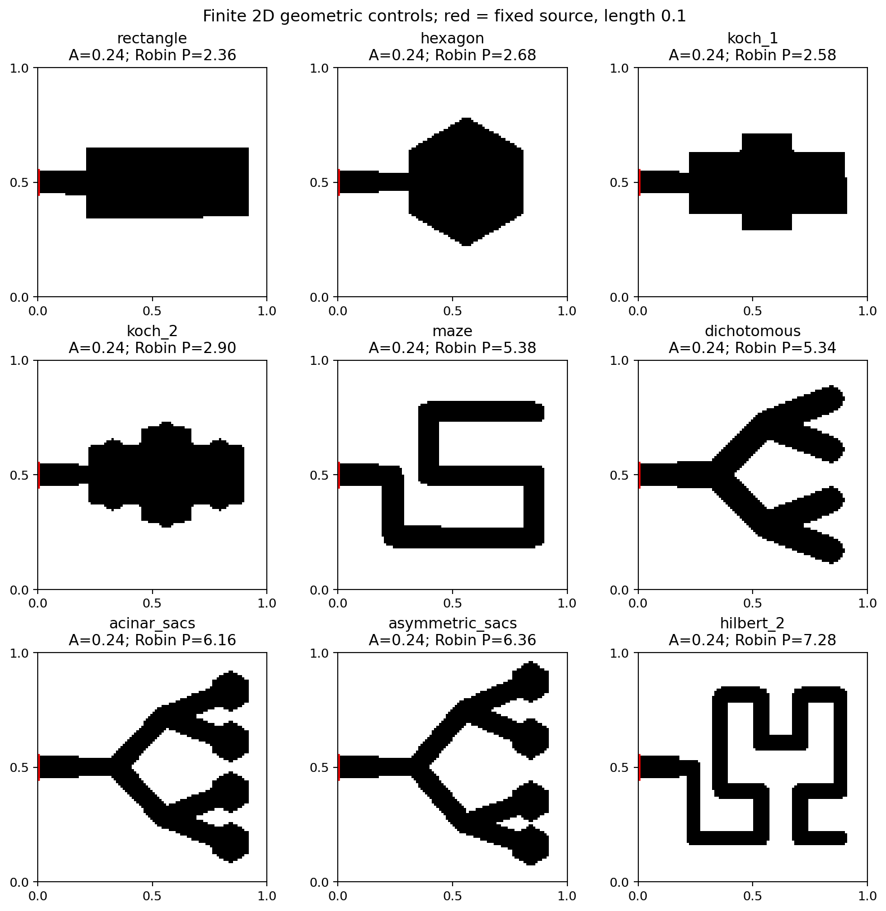

# Literature-inspired geometry study — main study complete

Launched 21 October 2026 at 13:26 Casablanca time (12:26 UTC), after **278 tests**
and Ruff checks passed. All 195 searches and independent endpoint checks finished
at about 14:18 UTC. The later combined regression passes 306 tests. The full journal review,
boundary sensitivity and 90 added classical controls are now complete.
The post-run curve correction and its regression record are retained separately.

Run: `20261021T122626095890Z_morphology_98e4aafa`.
Launch logs: `20261021T122623Z_027dc889` under experiment launches.
The launcher uses two below-normal-priority workers and one numerical thread each.

The [frozen protocol](morphology_protocol.md) and [literature review](morphology_literature.md)
describe nine finite geometric controls. The outcome-blind bank contains 45
distinct evaluation masks and seven training masks, with zero overlap. Source,
area, box, connectivity and feature criteria are shared. Search maximizes Q;
eta is diagnostic. The common perimeter cap is 8, rather than the historical 4.

Three methods compare greedy flux guidance, annealed flux guidance and an
online response regressor initialized from seven training families. Maze and
Hilbert families are absent from training. Main comparisons use five paired
search seeds. The long sac-family trajectories allow 1,024 evaluated changes
each. Separate controls hold actual starting perimeter exactly fixed.



The search journals every evaluated proposal and retains its best geometry
separately from the current exploratory state. Every returned endpoint and start
was refined and checked with independently assembled triangular FEM. Physical polygon tests
separately quantify raster-boundary bias.

The response model learns measured signed global flux changes; it is not a new
deep-RL/PINN model. These shapes are not anatomical reconstructions, and the
study does not assume nature-inspired shapes must win.

## Completed original comparison

All budgets complete, with no recorded interruptions. At 129 solves per main
trajectory, learned annealing wins 19 and loses 26 of the 45 paired Q400
comparisons against greedy flux; its mean difference is -0.004141622.
Independent practical energy ranges give 18 separated wins, 26 losses and one
overlap. No reliable overall learning advantage is established.

The 1,025-solve sac-family phase has median independently checked gains of
25.99% (greedy flux), 25.69% (annealed flux) and 23.51% (learned annealing).
The 65-solve exact-perimeter phase has median gains of 1.81%, 2.50% and 2.79%
across 15 starts per method, with zero measured perimeter drift. Phase budgets
differ; these gains cannot isolate a causal membrane effect or prove one
morphology superior across equal search effort.

The post-hoc highest fine-FEM endpoint is `search/d/06_0_1`: Q400=0.579831643,
FEM Q=0.581930801, area 0.24, Robin perimeter 7.82. Its Q400 gain over its own
start is 27.216%, with 30.333% more membrane; eta falls from 7.60% to 7.41%.
It is an edited sac proxy with most new absorption concentrated at x<0.5.
Its practical range [0.580117022,0.581930802] overlaps the greedy endpoint
`search/d/06_4_0`, so a unique highest-flux geometry is not established.
Of 195 endpoints, 194 have final lower estimates above their initial upper
estimates. Ranges concern the fixed staircase and practical floating guards,
not interval-arithmetic certification, biological variation or geometry bias.

The main study costs 38,069 solver calls, including training, search, catalog,
counterfactuals and independent validation. Additional classical controls and
boundary tests are accounted for separately. The
[generated report](../experiments/20261021T122626095890Z_morphology_98e4aafa/report.md)
and [mechanism figure](../experiments/20261021T122626095890Z_morphology_98e4aafa/postprocess/winner_mechanisms/report.md)
retain the full endpoint evidence.

The completed initial-bank sweep already shows why this distinction matters.
At Bi=1, the representative rectangle has Q400=0.492772 with perimeter 2.34;
the sac proxy has Q400=0.455786 with perimeter 6.00. This is a comparison of
unoptimized representatives under the common cap, not a matched-perimeter or
final optimized-family conclusion. Nature-inspired appearance does not establish
higher flux. At Bi=100, initial-family Q spread is only 0.0144%, while the largest
n200-to-n400 change is 2.148%; those tiny family differences are not resolved by
grid-change diagnostics alone. Inlet-wall sensitivity is being checked separately.

The complete main journal audit reconstructs 36,170 saved training/search fields
and exactly replays 12,288 regression updates across 202 trajectories. The added
controls audit another 11,610 fields. Their maximum relative conservation errors
are 6.33e-14 and 5.50e-14, respectively; replay performs zero PDE solves.
All 90 new searches complete their budgets. Uniform and paid-pool greedy lose
38/45 and 32/45 nominal comparisons against greedy flux, while the learned
method's 19/45 wins do not establish overall benefit. Total committed cost,
including separately charged boundary checks, is 50,721 solver calls.

The [paper review package](../experiments/paper_review_20261021/report.md)
collects 285 unique endpoints, 284 with separated improvement over their own
starts, and two unresolved leading masks. Its plots correct a post-run pandas
index-alignment issue; original figures and source diffs are preserved. Search
histories, fields, endpoint tables, learned weights and rankings are unchanged.

See [interpretation limits](morphology_limits.md), [energy estimates](complementary_flux_bounds.md)
and the independent [analytical 2D corner check](source_corner_limit.md).

The generated report.md, endpoint_metrics.csv, summary.json and figures are now
written. Supplemental review and the separate classical extension are complete, with
their own status files and launch records. Historical identity-guarded replay
uses archived executed sources; current plotting code includes the documented
post-run rendering correction. If a study is interrupted, preserve its
source identity when resuming:

```powershell
.\scripts\start_morphology_study.ps1 -ResumeRoot "experiments\20261021T122626095890Z_morphology_98e4aafa"
```

Interrupted uncommitted work is retained separately. Completed jobs and committed
solves are reused; source/config identity changes fail loudly.

Final corrected full regression: **310 passed in 511.75 seconds** on 21 October 2026.
The XML is retained in tmp/paper_gate_corrected_20261021/tests.xml and the review packet.
