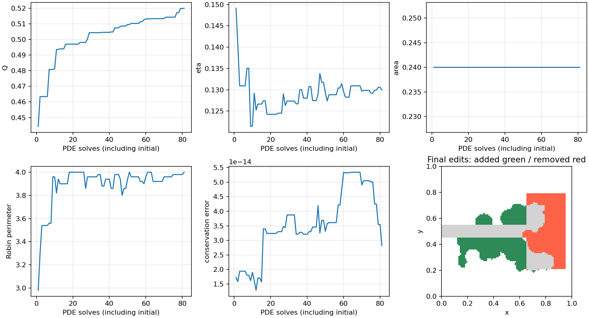
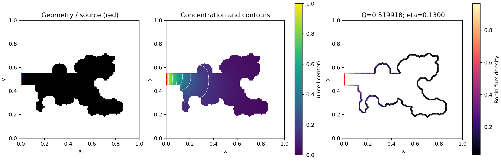

# Constrained random disk search (Milestone 3)

Validated 2026-10-18. The PDE reference and baseline tests still pass. A seeded
random disk search improves a deliberately screened deep-cavity geometry under
hard area, membrane, source, topology, and operational feature constraints.

## Exact problem and acceptance

The physical objective is total Robin flux Q. Optimization score is Q/Q_initial,
with no concentration-based deletion rule and no penalty replacing feasibility.
The air domain is a raster mask in the unit bounding box, initially the baseline
deep cavity of area 0.24. Bi=1. The west source is fixed at x=0 and
0.45<=y<=0.55. All other exposed faces are Robin.

Every candidate must satisfy:

- Area 0.24 within absolute tolerance 1e-12, achieved by equal added/removed cell counts.
- Robin perimeter <=4.0, measured from exposed cell faces.
- Every cell in the entire collar x<0.12 retains its initial inside/outside status.
- Source face identities and exposure are unchanged; air is one face-connected component.
- No internal holes.
- The feature-opening test below on the search grid and both validation grids.

Only a geometrically valid candidate is solved. Accept it if
`Q_candidate > Q_current + 1e-7`; otherwise retain the current mask. This is
greedy local search, with one candidate per attempt. It claims no global optimum.

## Proposal distribution

Select uniformly over eligible equal-length Robin boundary faces, outside the
source collar plus a two-cell margin. Estimate outward normal from a Gaussian
smoothed indicator gradient (sigma one cell), falling back to the face normal.
Sample radius uniformly in [0.05,0.08] and angle uniformly within +/-pi/3 of that
normal. Place the addition center at `p + 0.25*r*direction`, plus a uniform
subcell offset in [-0.2h,0.2h] per coordinate. Reject disks extending beyond the
bounding box; no clipping is used to hide a boundary violation. Every primitive
disk radius must be at least 3h.

Choose a removal donor uniformly over eligible faces, independently of the
concentration field. Center its disk at `p - 0.25*r*normal`, with the same
subcell jitter. Select its radius by an order statistic of squared distances to
original interior cells, so it removes exactly as many cells as the addition
creates. Reject ties, overlap with the new addition, or a removal radius outside
[3h,2r]. All original cells, including protected cells, participate in this
geometric disk operation; a source violation is rejected, never silently repaired.
Standalone Boolean addition and removal primitives are also available and tested.

## Operational feature constraint

Let r=minimum_feature_width/2=0.02. Open the mask with a physical disk of radius r.
Require the remaining core to be nonempty, connected, and attached to the source.
Each original air cell must be within `r/2 + sqrt(2)*h` of this core. The residual
allowance permits raster corner rounding while rejecting long thin appendages.
This is a declared raster morphology criterion, not a certified continuum neck
width. Candidate checks repeat it after 2x and 4x cell subdivision before any
candidate PDE solve. It rejects necks that disappear under opening on those grids.

An early version checked only the search grid. It found a thin appendage whose
feature test failed after refinement; that run was rejected. The implementation
now filters such proposals before acceptance. The refinement test was retained.

## Reproducible result

Seed 42, grid 100x100, 81 search PDE solves including the initial solve, 2217
proposal attempts, 37 accepted edits. The attempt cap is 30 times the solve budget;
invalid proposals consume wall time but no PDE solve. A budget shortfall fails
loudly. Four extra PDE solves validate initial and final shapes at finer grids.

| Grid | Initial Q | Final Q | Absolute gain | Constraints |
|---:|---:|---:|---:|---|
| 100 | 0.4443664781 | 0.5199183023 | 0.0755518243 | pass |
| 200 | 0.4445485604 | 0.5211161809 | 0.0765676205 | pass |
| 400 | 0.4445993206 | 0.5215729197 | 0.0769735991 | pass |

Coarse flux gain: **17.00%**. Finest-grid gain: **17.31%**. The last change in
gain is 0.00040598, much smaller than the gain. This is observed grid sensitivity,
not a formal continuum error bound. Refinement subdivides the same physical
staircase geometry, preserving its area, source, and exposed-face perimeter.

Final area is 0.24 and Robin length is 4.0. Source and protected collar are
unchanged. Eta changes from 0.149116 to 0.129980: total transfer increases while
fractional membrane utilization decreases as more of the allowed membrane is used.
Maximum search conservation error is 5.35e-14; finest-grid error is 4.50e-13.
Search, plotting, and refinement took about 44.4 seconds on this host.





Full run: `experiments/20261018T191710852367Z_optimize_disks_6c2e200b/`.
[Summary](data/optimization_summary.json) and
[refinement data](data/optimization_refinement.csv) are retained in the repository.
The experiment saves every attempted step's current mask, physical history,
proposal parameters/rejections, initial/final fields, seed, configuration,
tolerances, source snapshot, environment, and Git state.

```powershell
.\.venv\Scripts\python.exe -m oxygen_shape.cli optimize --config configs/optimize_disks.yaml
```

## Failure modes and scope

Rejections include perimeter excess, collar edits, disconnected opening cores,
thin appendages, disk overlap, out-of-box additions, and unsuitable balancing
radii. Many attempts are rejected; proposal feasibility is a substantial cost.
Minimum feature checking also consumes time without consuming a PDE solve.

Only one initial geometry and Bi are demonstrated here. The RL comparison uses
five held-out seeds in the accompanying experiment. The per-grid symmetry of
ideal curves, smooth-boundary flux accuracy, and global optimality are not claimed.
Roughness has no separate penalty; it is recorded as unmeasured, with raster
perimeter and feature constraints providing the declared geometric controls.
