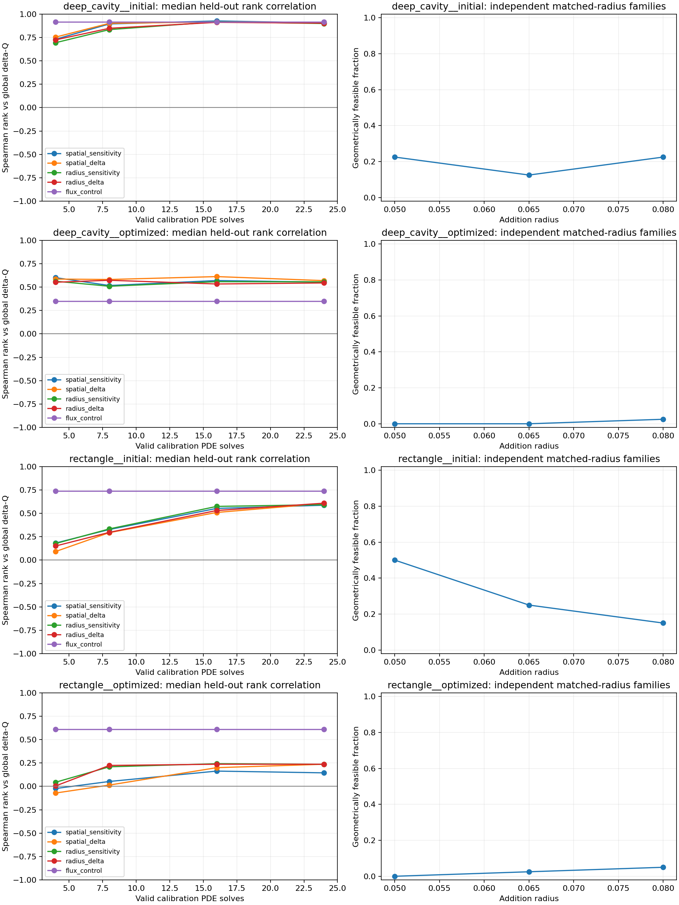

# Frozen optimized-incumbent prediction results

Completed 2026-10-19. All 20 replicates and 40 calibration/held-out quotas
completed without relaxing constraints or increasing the prespecified attempt
budget. The study used **1531 PDE solves**, including numerical refinement.
It measures prediction on fixed inputs; no candidate was accepted, and no RL
checkpoint or search score was changed.

The principal findings are a sharp decline in feasible proposal yield near the
membrane budget and shape-dependent ranking performance. Empirical sensitivity
outperforms the flux control in rank correlation on this optimized deep cavity,
but performs poorly on the optimized rectangle. This does not establish an
optimization advantage or justify promoting a predictor.

## Reproduce and inspect

```powershell
.\.venv\Scripts\python.exe -m oxygen_shape.cli diagnose-prediction --config configs/optimized_prediction.yaml
```

- [Prespecified protocol](optimized_prediction_method.md)
- [Complete experiment report](../experiments/20261019T000516608452Z_prediction_diagnostic_8b545e98/report.md)
- [Summary](data/optimized_prediction_summary.json), [scores](data/optimized_prediction_scores.csv),
  [quotas](data/optimized_prediction_quotas.csv), and [fixed inputs](data/optimized_prediction_fixed_cases.csv)
- [Input identities and checksums](data/optimized_prediction_input_manifest.json)
- [Refinement results](data/optimized_prediction_refinement.csv)

Full masks, fields, attempted edits, signed predictions, environment versions,
configuration, input copies and source snapshots remain in the experiment
directory. Git commit is null because the repository has no commit; a source
snapshot records the executed implementation.

## Fixed inputs and constraints

The optimized inputs are the **first uniform seed-8000 outputs** of the prior
sensitivity benchmark, selected by that rule before this diagnostic. They were
not selected for maximum flux. The loader checks pinned file SHA-256 hashes,
source seed/method/completion status, physics, grid, solver settings, constraints,
canonical initial masks and geometry validity. It copies all four source files
per input and recomputes every baseline Q before sampling any candidate.
Post-run verification confirms that source and copied files still match.

All cases use Bi=1, n=100, exact area 0.24, Robin perimeter at most 4.00,
the same protected source/collar, unit footprint, connected air domain without
holes, and the existing 0.04 feature proxy at grids 100/200/400.

| Case | Q | Robin perimeter | Fraction of perimeter budget |
|---|---:|---:|---:|
| Deep cavity, initial | 0.44436648 | 2.98 | 74.5% |
| Deep cavity, optimized | 0.49735743 | 4.00 | 100% |
| Rectangle, initial | 0.48707257 | 2.34 | 58.5% |
| Rectangle, optimized | 0.51272518 | 3.96 | 99% |

Five fresh replicates use calibration seeds 8400–8404, held-out seeds
9400–9404 and independent radius-family seeds 10400–10404. Each replicate
collects 24 unique valid calibration edits and 48 disjoint held-out edits.
Prefixes 4/8/16/24 reuse the same held-out pool; they are not independent tests.
Each pool has a hard cap of 6000 attempts. No pool exhausted that cap.

## Feasibility and cost

| Fixed case | Valid pool edits / attempts | Valid yield | Independent radius variants feasible / attempted |
|---|---:|---:|---:|
| Deep cavity, initial | 360 / 1731 | 20.80% | 23 / 120 |
| Deep cavity, optimized | 360 / 32061 | 1.12% | 1 / 120 |
| Rectangle, initial | 360 / 952 | 37.82% | 36 / 120 |
| Rectangle, optimized | 360 / 8375 | 4.30% | 3 / 120 |

There were no duplicate-mask rejections in these pools. The optimized deep
cavity required 18.5 times as many attempts as its initial control to collect
the same number of valid edits; the rectangle required 8.8 times as many.
Perimeter violations are the most frequent rejection category for both
optimized cases, often combined with other constraint violations. The states
also differ in shape, so this comparison does not isolate the causal effect of
perimeter saturation.

Independent radius families do not condition their face-pair selection on
feasibility. At radii 0.05/0.065/0.08, feasible counts out of 40 are 9/5/9 for
the initial deep cavity, 0/0/1 for its optimized state, 20/10/6 for the initial
rectangle and 0/1/2 for its optimized state. These small late-state counts do
not support a radius-response conclusion. None of the 80 optimized-state
families was feasible at every radius.

Total solves: 4 baseline + 480 calibration + 960 held-out + 63 feasible radius
variants + 24 refinement = **1531**. The 43599 attempted proposals include
480 independent radius variants. Runtime was 722.5 seconds on this machine;
this was not a comparative timing benchmark.

## Held-out ranking

The current spatial-sensitivity score estimates a signed local response per
reallocated area and clips negative predictions for ranking, as in the sampler.
These scores are not calibrated delta-Q forecasts. The table reports medians
across five replicates at 24 calibration solves; brackets show the first and
third quartiles of rank correlation. All five correlations are defined in every
case for both scores. Top-quartile ties receive fractional selection weights.

| Fixed case | Sensitivity rho vs delta-Q [Q1, Q3] | Flux-control rho [Q1, Q3] | Sensitivity top mean delta-Q | Flux top mean delta-Q |
|---|---:|---:|---:|---:|
| Deep cavity, initial | 0.906 [0.904, 0.937] | 0.918 [0.795, 0.927] | +0.011468 | +0.014466 |
| Deep cavity, optimized | 0.553 [0.475, 0.568] | 0.348 [0.156, 0.400] | +0.000315 | +0.000228 |
| Rectangle, initial | 0.587 [0.567, 0.626] | 0.741 [0.738, 0.763] | +0.004976 | +0.005589 |
| Rectangle, optimized | 0.145 [0.062, 0.237] | 0.610 [0.540, 0.651] | -0.001637 | +0.003015 |

Sensitivity has higher rank correlation than flux in all five optimized
deep-cavity replicates and none of the five optimized-rectangle replicates.
On the deep cavity, flux nevertheless has a larger median top-minus-pool
statistic (0.000798 versus 0.000613); differences in ranking, selected gain and
enrichment should not be conflated. Medians of differences also need not equal
differences of medians.

With four calibration solves, the current map has median correlations 0.7318,
0.6014, 0.1832 and -0.0228 in table order. More probes do not uniformly improve
the optimized deep cavity. Radius-conditioned and absolute-response variants
remain descriptive ablations: none consistently surpasses the flux control
across both optimized inputs, and no variant is selected using these test data.



## Classification and numerical limits

Median fractions of resolved positive held-out effects are 89.6%, 56.3%, 87.5%
and 14.6% in table order. Thus sign accuracy requires both majority-class
baselines. On the optimized rectangle, the current score's median sign accuracy
is 62.5%, versus 14.6% for always-positive and **85.4% for always-negative**.
Even the radius/absolute variant's 81.3% does not beat that negative baseline.
An apparent improvement over always-positive alone would be misleading here.

Maximum relative conservation error is 6.243e-13. The largest positive and
negative held-out effects in each case retain their signs at resolutions
200 and 400. Those selected checks do not validate every coarse ranking or
provide a continuum error bound for the staircase geometry.

The five replicates sample one fixed incumbent per family, not five independent
optimized geometries. Valid-pool prediction is conditional on different feasible
candidate populations in each state. Equal seed labels do not imply identical
physical edits. Results apply to Bi=1 and these discrete inputs; they do not
establish a general trajectory effect, global optimality or saved PDE solves.

## Implementation and next step

The frozen-input loader, relative-path configuration, case labels, full input
verification before sampling, portable input snapshots and incomplete-quota
reporting are implemented. The full regression suite passes **181 tests**;
Ruff lint and format checks pass. Final artifact checks confirm exact solve
accounting, disjoint calibration/test masks and unchanged source checksums.

Next, specify a geometry-only feasibility improvement for paired edits near
the membrane budget. Compare it against the existing sampler with unchanged
constraints, recording acceptance yield, proposal time and distributional
coverage before an equal-PDE-budget search comparison. Freeze that revision
before using fresh evaluation seeds. Keep the current RL checkpoint and
predictors unchanged; a reliable advantage remains unestablished.
