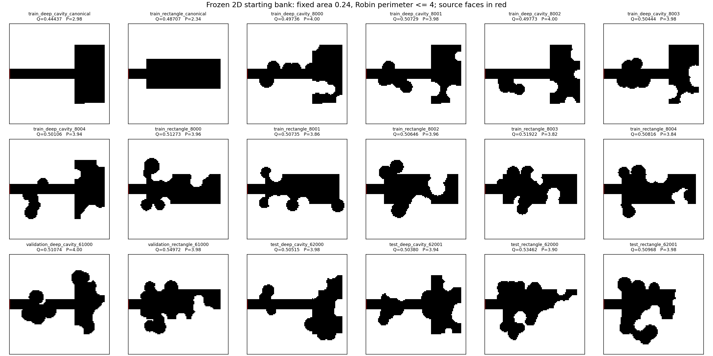
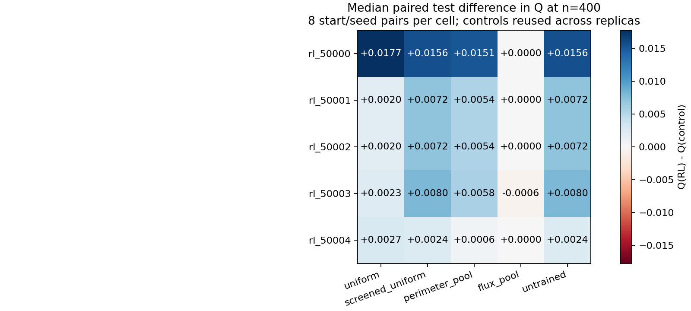
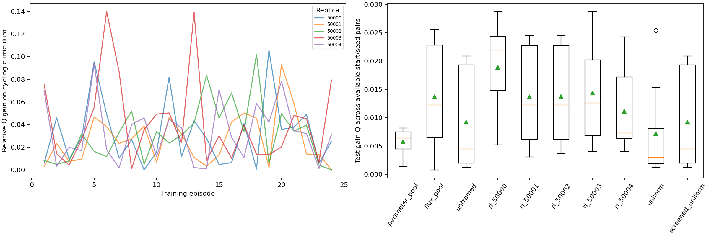

# RL with strong baselines and validated starting geometries

Completed 2026-10-19. The training pipeline is implemented and its first bounded
study is complete: **five trained policies, 120 completed training episodes and
100 completed held-out rollouts**, with **4594 new experimental PDE solves**.
The learned selectors beat ordinary uniform search more often on these tests,
but do not establish an advantage over the current-flux pool heuristic. Every
final replica is retained; no checkpoint or default is promoted from these results.

## Inspect or reproduce

- [Fixed protocol and equations](pioneer_rl_method.md)
- [Complete run report](../experiments/20261019T031120855645Z_pioneer_rl_4ad9c2ee/report.md)
- [Summary](data/pioneer_rl_summary.json), [starting-bank manifest](data/pioneer_rl_bank_manifest.json),
  [readiness checks](data/pioneer_rl_readiness.json)
- [All training episodes](data/pioneer_rl_training.csv),
  [all held-out outcomes](data/pioneer_rl_evaluations.csv)
- [Test method summaries](data/pioneer_rl_test_methods.csv),
  [family summaries](data/pioneer_rl_test_families.csv),
  [all paired comparisons](data/pioneer_rl_test_pairs.csv)
- [Artifact audit](data/pioneer_rl_artifact_audit.json),
  [metadata correction](data/pioneer_rl_metadata_correction.json)

```powershell
.\.venv\Scripts\python.exe -m oxygen_shape.cli train-rl-candidates --config configs/train_rl_candidates.yaml
```

`--prepare-only` builds the bank and checks readiness. `--resume "RUN_DIRECTORY"`
continues a source/config-compatible run. Atomic policy files contain weights,
feature schema, update count, completed-episode history and the run identity.
The five completed checkpoints are in the production run's `policies/` directory.
The previous tabular policy files are unchanged.

## Starting bank and numerical rules

There are 12 training, 2 validation and 4 test masks, all with distinct hashes.
Training includes two canonical curriculum cases and ten pinned improvements
from previous uniform searches. These are development inputs, not new independent
evidence. Before any learning, three fixed controls generated the held-out starts;
selection used their n=400 Q under the prespecified quality rule. All 18
generation jobs met that rule. Every bank mask was checked at 100/200/400.



All cases use dimensionless Bi=1, a unit box, area 0.24 within 1e-12,
Robin perimeter at most 4, the same source of length 0.1 and protected collar
of length 0.12, connected no-hole air domains, and the existing operational
minimum-feature width 0.04 checks at 100/200/400. This is an opening/residual
criterion, not an exact continuum neck-width certificate. Perimeter is bounded,
not matched exactly. Higher Q does not imply higher membrane efficiency eta.

Each episode or evaluation allows 17 PDE solves including its initial state,
and at most 6000 raw disk pairs. Pool selectors draw eight candidates and retain
the 25% unconditional uniform branch. Uniform uses one draw per decision.
Only a measured global Q increase above 1e-7 accepts an edit. Candidate field
responses and fine-grid outcomes never enter the action features.

## Training and held-out results

Five replicas use seeds 50000--50004 and 24 episodes each, cycling through all
12 training starts twice. Their update counts are 3037, 3068, 3331, 3217 and
2973: **15626 total updates**. There are no incomplete episodes. All weights
remain finite; maximum absolute weights lie between 0.0864 and 0.1209.
Curriculum cases vary by episode, so the training curves are not learning or
convergence proofs.

There are 20 validation rollouts and 80 test rollouts. Each method sees the
same four test starts and two rollout seeds. All five final models are evaluated,
with no selection or tuning from validation/test results. The following medians
use all eight test start/seed combinations per method. Gains are re-solved on
the same physical staircase geometry at n=400; eta and environment timing are
reported at n=100.

| Method | Complete test runs | Median gain Q, n=400 | Median eta, n=100 | Median environment seconds |
|---|---:|---:|---:|---:|
| Uniform | 8/8 | 0.003158 | 0.131415 | 7.592 |
| Screened uniform | 8/8 | 0.004525 | 0.133425 | 5.523 |
| Minimum perimeter pool | 8/8 | 0.006517 | 0.131681 | 5.764 |
| Current-flux pool | 8/8 | 0.012412 | 0.133043 | 5.893 |
| Untrained selector | 8/8 | 0.004525 | 0.133425 | 5.461 |
| RL 50000 | 8/8 | 0.022475 | 0.134724 | 6.221 |
| RL 50001 | 8/8 | 0.012412 | 0.132873 | 6.591 |
| RL 50002 | 8/8 | 0.012412 | 0.132873 | 5.954 |
| RL 50003 | 8/8 | 0.012741 | 0.133580 | 5.781 |
| RL 50004 | 8/8 | 0.007392 | 0.131850 | 6.130 |

All 80 test gains remain positive at n=400; the smallest is 0.0008043.
All 100 evaluation gains exceed their last observed refinement change. This
is an empirical staircase-grid sensitivity check, not a continuum error bound.

The paired counts below are n=400 wins/ties/losses with tolerance 1e-7.
Each cell contains the same eight start/seed pairs.

| Replica | Versus uniform | Versus screened/untrained | Versus minimum perimeter | Versus current flux |
|---|---:|---:|---:|---:|
| 50000 | 6 / 0 / 2 | 6 / 0 / 2 | 8 / 0 / 0 | 3 / 2 / 3 |
| 50001 | 6 / 0 / 2 | 5 / 0 / 3 | 5 / 1 / 2 | 2 / 3 / 3 |
| 50002 | 6 / 0 / 2 | 5 / 0 / 3 | 5 / 1 / 2 | 2 / 3 / 3 |
| 50003 | 6 / 0 / 2 | 5 / 0 / 3 | 6 / 0 / 2 | 2 / 2 / 4 |
| 50004 | 6 / 0 / 2 | 5 / 0 / 3 | 6 / 1 / 1 | 4 / 1 / 3 |

Descriptive totals are 30/0/10 versus uniform, 26/0/14 versus screened-uniform
or untrained, 30/3/7 versus minimum perimeter, and 13/11/16 versus current flux.
The controls are reused across replicas; these are **not 40 independent trials**.
Screened-uniform and the zero-weight selector produce identical seeded final
fluxes, as intended. One comparison against current flux changes classification
between n=100 and n=400, which is why refined counts are the primary table.



Measured paired environment-time ratios RL/uniform have medians 0.648--0.754
across replicas, while RL/current-flux medians are 0.996--1.055. These timings
exclude final state/CSV serialization and refinement and include candidate NPZ
writing. They do not include or amortize training. This is not evidence of a
complete-workflow speedup. See the protocol for timing boundaries.

Across test trajectories, learned selectors have multiple cheap-pass candidates
in about 33--38% of decisions; the rest offer zero or one screened alternative.
Cheap eligibility does not establish full geometric feasibility. The first
deep-cavity validation case has only about 10% such decisions. These descriptive
counts help locate limited decision opportunities; they do not prove why any
policy wins. See [selection opportunities](data/pioneer_rl_test_selection_opportunities.csv).



## Costs, provenance and verification

| Experimental phase | New PDE solves |
|---|---:|
| Pioneer preparation | 414 |
| Solver/control/checkpoint preflight | 40 |
| Training | 2040 |
| Frozen held-out evaluation | 1700 |
| Evaluation refinement | 400 |
| Total | 4594 |

Reused pioneers have an additional recorded generating-run cost of 450 solves,
kept separate from new experimental work. Regression-test computations are
outside this experiment count. Preparation took about 142 seconds; the resumed
training/evaluation invocation took about 1454 seconds on this machine, excluding
the later artifact audit, regression tests and report correction.

Full regression after the reporting fix: **201 passed**. Ruff checks pass.
The post-run audit verifies 3520 candidate solve artifacts, 276528 charged raw
draws and 40376 selected decisions across training/evaluation, plus final weights,
rewards, protected collars, cell counts, concentration bounds and frozen model
digests. All 100 refinements satisfy the existing constraints. Maximum relative
conservation error over the study is **5.8252e-13**. Seeds, configuration, solver
tolerances, package versions, source snapshots and mask hashes are saved. Git
commit is null because this repository has no commit.

The audit found an aggregate-export bug: a generic `method=learned` value
overwrote the five replica labels. Fifty labels were corrected using unique job
names and verified checkpoint digests; all physical record hashes and checkpoint
file hashes remain identical. No PDE solve or training update was repeated.
Original exports/figures are preserved in `before_metadata_correction/`; the
correction manifest and exact source patch are retained. The production source
snapshot and run identity are unchanged. One live source file now includes the
reporting fix, covered by an expanded end-to-end regression test including frozen
digest rejection on resume.

The strict source guard therefore rejects the current corrected code if asked
to resume this already completed old-source run. Its checkpoints still load
with their recorded identity; new runs use the corrected code and their own
identities. No source guard, checkpoint identity or old model was bypassed or
rewritten to conceal this correction.

## Next scientific step

Retain current-flux and untrained controls. Investigate candidate-choice quality
and sparse feasibility on development cases before increasing model complexity.
Any reward, feature or training-budget revision needs a frozen protocol, explicit
development/validation selection, and a fresh final test bank; the present test
starts and seeds are now development knowledge. An equal-wall-time comparison
remains pending, with preparation/training costs included. These results cover
two related 2D families at Bi=1, not unseen geometry families, permeability regimes
or pulmonary anatomy. The scientific advantage gate remains open, and advanced
Monte Carlo, moving-boundary differentiation and 3D remain gated.
