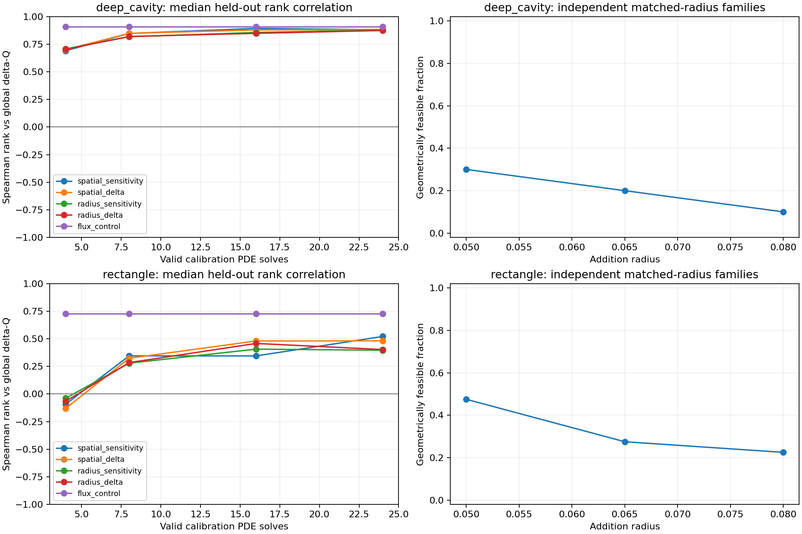

# Fixed-geometry prediction diagnostic

The diagnostic implementation and prespecified study are complete. The current
empirical map contains predictive information, but the existing flux heuristic
is a stronger ranking control on these two initial geometries. No optimizer or
checkpoint was changed using the held-out scores.

```powershell
.\.venv\Scripts\python.exe -m oxygen_shape.cli diagnose-prediction --config configs/prediction_diagnostic.yaml
```

[Full report and tables](../experiments/20261018T235136379254Z_prediction_diagnostic_a47b99ca/report.md),
[frozen protocol](prediction_method.md), [scores](data/prediction_scores.csv),
[summary](data/prediction_summary.json).

## What was tested

Five replicates for each of the deep-cavity and rectangle families, Bi=1, n=100.
Calibration seeds 8200–8204, test seeds 9200–9204 and independent radius-family
seeds 10200–10204. Each replicate fits on 24 unique valid edits and evaluates
48 different valid edits of the same fixed geometry. Calibration/test masks
are disjoint within each replicate. Prefix sizes 4/8/16/24 reuse the same test
pool, and their results are not independent experiments.

Four prespecified scores compare signed spatial kernel sums of delta-Q or
delta-Q/reallocated-area, with or without a radius kernel. The actual sampler's
nonnegative clipping is applied before ranking; tied top scores receive
fractional weights, independent of the observed answer. These are ranking
scores, not calibrated numerical flux forecasts or formal shape derivatives.

All 20 calibration/test quotas were met. The study used **797 PDE solves**:
2 baselines, 240 calibration edits, 480 held-out edits, 63 feasible radius
variants and 12 refinement solves. Every attempted edit, including rejection
and RNG seed, is retained. Maximum conservation error is below 2.845e-13.
Positive and negative selected held-out effects keep their signs at 200/400.
The final regression suite passes 168 tests, including disjoint pools, fixed
base geometry, score equivalence, unbiased tie handling, cost accounting,
reproducibility, quota exhaustion and retained numerical-failure logs. Ruff lint
and formatting checks pass.

## Predictive ranking

Median Spearman correlation [interquartile range] across five replicates,
against actual global delta-Q on the held-out pool:

| Shape | Current map, 4 probes | Current map, 24 probes | Flux score, no extra probe solves |
|---|---:|---:|---:|
| Deep cavity | 0.692 [0.614, 0.803] | 0.882 [0.880, 0.892] | 0.908 [0.905, 0.921] |
| Rectangle | -0.092 [-0.239, -0.009] | 0.522 [0.450, 0.552] | 0.727 [0.657, 0.787] |

More calibration data improves the rectangle's ranking substantially, although
the prefix curves are not monotonic. The four-probe setting used by the search
is weak on this rectangle. This is consistent with sparse calibration being a
limitation, but the diagnostic does not establish the cause of every earlier
optimization outcome. Twenty-four calibration solves also consume most of a
41-solve search budget; stronger prediction is not automatically more efficient.

At 24 probes, radius-conditioned per-area scores have correlations 0.880 and
0.397. Absolute-delta scores give 0.884 and 0.482; radius-conditioned absolute
scores give 0.875 and 0.403. None shows a consistent improvement over the current
spatial per-area score in both families. This tests the prespecified bandwidths,
not every possible use of radius or absolute gain.

The flux control also selects stronger top-quartile gains. Median top-quartile
mean delta-Q is 0.01736 versus 0.01269 for the current map on the deep cavity,
and 0.00623 versus 0.00492 on the rectangle. These are retrospective diagnostic
selections from fully evaluated test pools, not demonstrated saved solves.

Current-map sign accuracy is about 91.7% in both families. Always predicting a
gain already achieves median accuracies of 87.5% and 85.4%. Classification
accuracy therefore needs this baseline; it cannot stand alone as evidence of a
strong optimizer. The per-replicate values and defined-correlation counts are
preserved in scores.csv.

## Radius and feasibility

Forty independent uniform face-pair families per shape replay the same angle
and jitter at three radii. Every family enters regardless of whether any edit
is feasible or useful.

| Shape | Feasible at radius 0.05 | Radius 0.065 | Radius 0.08 |
|---|---:|---:|---:|
| Deep cavity | 12/40 | 8/40 | 4/40 |
| Rectangle | 19/40 | 11/40 | 9/40 |

Only 7/80 families are feasible at all radii; 31/80 have a mix of feasible and
infeasible variants. Larger radii are less feasible in this sample. A radius
feature can therefore matter for feasibility even though this tested response
kernel does not improve ranking. Since feasible subsets differ by radius,
differences in their median Q gains cannot be attributed solely to radius.



## Limits and next step

These are coarse-grid prediction metrics on the **unedited initial shapes**.
Only selected extreme effects undergo full PDE refinement; their signs survive,
but this does not validate every candidate's continuum ranking. Staircase
orientation bias, feasible-pool conditioning, one Bi and five replicates limit
generalization. The plot shows replicate medians; individual results are in
the data rather than a confidence claim.

Next, repeat the diagnostic on frozen optimized incumbents near the membrane
budget. That will test whether predictive quality and feasibility deteriorate
during search, before choosing a revised proposal policy. Use new calibration
and test seeds. Preserve the flux control, charge every probe, and keep any
revised optimizer's evaluation separate from this diagnostic dataset.
