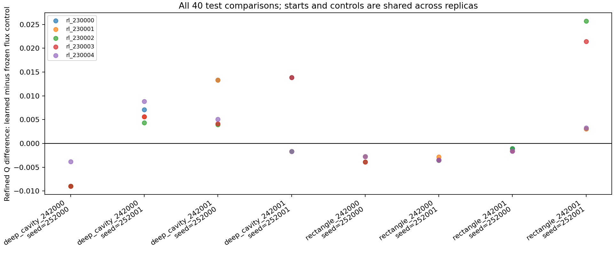
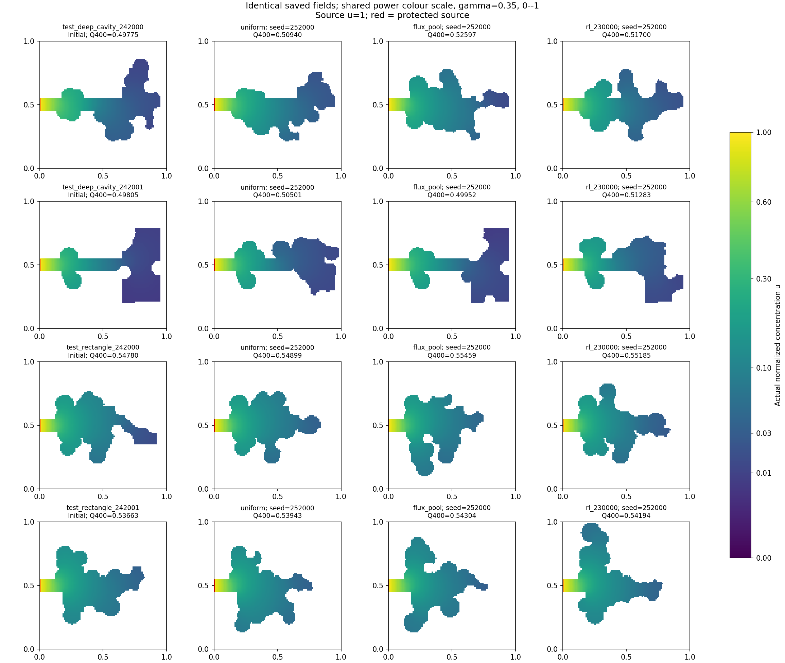

# Completed RL training with admissible candidate pools

Production run: `experiments/20261019T133653820304Z_pioneer_rl_2382a80e`.
The [protocol](refill_rl_protocol.md) and config were frozen before outcomes.

Five independent linear Expected Sarsa policies each completed 24 episodes:
120 episodes, 2573 actual parameter updates, and no exhausted episode budgets.
This is CPU RL training, not a GPU neural-network run. The complete pipeline
took 2280.65 seconds (38.01 minutes), including preparation and evaluation.

| Phase | New PDE solves |
|---|---:|
| Prepare 12 training, 2 validation, 4 test starts | 414 |
| Analytical/environment/checkpoint preflight | 40 |
| Train five policies | 2040 |
| Evaluate all policies and controls, 120 rollouts | 2040 |
| Refine held-out endpoints at 200 and 400 | 480 |
| Total | 5014 |

There were no interrupted attempts. The 450 solves originally used to generate
the reused training pioneers are historical and separate. Generation excluded
771 previously known masks from the new held-out selection. All 18 bank masks
are distinct across splits; neither validation nor test selected a replica.

The pools now offer at least two admissible choices in 96.70% of training
decisions and 97.03% of learned test decisions. Training still has 25.38% invalid
selections because the deliberately retained exploration floor samples the
first raw proposal regardless of eligibility. All raw draws and checks count.
The maximum episode used 5942 of the 6000 allowed draws. The next pool used by
Expected Sarsa is charged once and then consumed by the next transition.

Refined comparisons on four fresh test starts and two rollout seeds per start:

| Control | Learned wins / ties / losses | Mean delta Q | Median delta Q | Median workflow-time ratio |
|---|---:|---:|---:|---:|
| Raw uniform | 29 / 0 / 11 | +0.00482035 | +0.00250338 | 3.763 |
| Screened pool uniform | 27 / 0 / 13 | +0.00675397 | +0.00333269 | 1.125 |
| Minimum perimeter | 29 / 0 / 11 | +0.00226364 | +0.00387863 | 1.195 |
| Frozen flux heuristic | 17 / 0 / 23 | +0.00177676 | -0.00164557 | 1.052 |
| Untrained zero-score pool policy | 27 / 0 / 13 | +0.00675397 | +0.00333269 | 1.124 |

The 40 rows per control share starts, seeds and controls across five replicas;
they are not 40 independent trials. Every comparison has the same coarse PDE
budget. Workflow times include selection, geometry and artifact writing, and
exclude endpoint refinement. Raw uniform is much cheaper, so its win count
does not establish an advantage at equal wall time.

The learned test geometries improve refined Q over their own starting shapes
by a median 1.224%, range 0.059% to 6.368%. These within-run gains alone do not
demonstrate a learning advantage: the controls also perform global PDE search.
There are 23 distinct final masks across the 40 learned test outcomes.

The mean advantage over flux is driven by a few larger gains, while its median
is negative and 23/40 comparisons lose. On validation, flux also wins 13/20
comparisons and the learned mean delta Q is -0.00779696. A dependable advantage
over the strongest fixed heuristic is therefore not established. Keep all
five research checkpoints; do not promote a default or pick the best test seed.

Points can overlap when replicas produce the same endpoint. The eight groups
are the shared start/seed pairs, not independent repeats for every replica.

The geometry panel uses the first configured replica (230000) and first test
rollout seed (252000), not the best-looking outcome. All four test starts are
shown. Fields are saved n=100 solutions with a shared power color scale gamma
0.35 on actual u in [0,1]; titles separately report Q refined to n=400. Source
u remains one and red highlights the protected source. Plot colors never enter RL.

Verification: 231 tests pass in 127.95 seconds, with Ruff checks passing. All
78 executed source hashes match. The maximum solver-reported conservation
error is 5.71457e-13. An isolated copy of the completed run resumes with all
120 episodes and 120 evaluations skipped, zero new PDE solves, and all five
checkpoint files unchanged. The production summary remains unchanged.

Detailed artifact verification passes and is recorded in `artifact_audit.json`:
271 rollouts, 4977 saved fields, 4154 exact selected geometry-edit replays and
2573 policy-update replays, with zero new PDE solves. It verifies 572671 charged
raw draws, 110760 full geometry checks and 1849 accepted edits across all phases.
The maximum independently recomputed conservation error is 5.73266e-13.
The 36 training
bank checks and one analytical preflight field were not persisted as arrays;
their logged diagnostics remain separate from the saved-field audit.

All five audited checkpoints, per-file hashes, run identity and model cards are
retained in `models/refill_rl_2382a80e/`. The experiment also retains exact copies
of the postprocessing helpers and a SHA256 manifest in `supplemental_scripts/`.

The next development priority is to test whether longer training or richer
observations improve selection beyond the fixed flux prior. First retain an
explicit zero-residual flux control, report dependence on starting shape, and
use fresh held-out masks for any future final comparison. Reusing these test
outcomes for design makes them development knowledge. Equal-time performance,
transfer across Bi and a neural/GPU policy remain unestablished.
