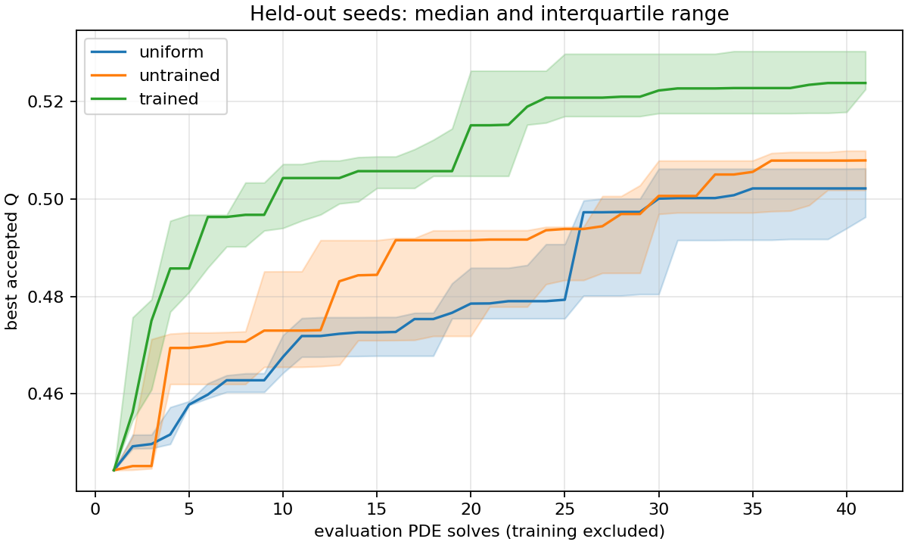
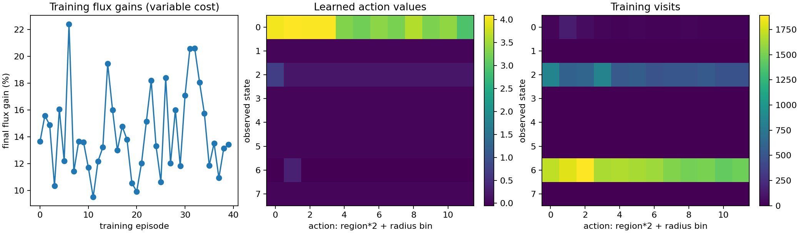

# Reinforcement learning disk-proposal experiment

Tabular Q-learning chooses a boundary region and radius bin. The deterministic PDE solver evaluates every valid candidate, and greedy acceptance uses global Q.

Validated 2026-10-18: **111 tests passed in 27.49 seconds**, with Ruff lint and
format checks passing. Training and all fifteen fixed-budget evaluation runs
completed. The policy is saved at [models/disk_q_policy.npz](../models/disk_q_policy.npz)
with its [metadata](../models/policy_metadata.json). See [the method](rl_method.md).

Run: `experiments/20261018T193101833648Z_rl_frozen_benchmark_e68c1d39/`.
Original training: `experiments/20261018T191956689594Z_rl_disk_policy_5681afea/`.

Machine-readable repository copies: [evaluations](data/rl_evaluations.csv),
[training](data/rl_training.csv), [summary](data/rl_summary.json), and
[learned values and visits](data/rl_policy_values.csv).

## Fixed problem and controls

Grid 100x100, Bi=1, initial body deep_cavity, area 0.24, Robin budget 4, fixed unit box, source length 0.1, protected collar x<0.12. Feature-opening width 0.04; no holes or disconnected air.

Area is preserved by paired disk addition/removal, with radii at least 3h. Coarse and refined morphology checks precede candidate PDE solves. The feature criterion is an operational raster opening test, not a proven continuum minimum-neck bound.

Training: 40 episodes, at most 25 solves and 750 attempts per episode. Actual cost is recorded. Evaluation seeds: [100, 101, 102, 103, 104], disjoint from training. Each evaluation uses 41 PDE solves, including its initial solve. Invalid proposals consume attempts and wall time but no PDE solve. All three policies use identical feasibility, reward accounting, and acceptance rules. During evaluation, after 50 consecutive invalid proposals, the learned and untrained policies switch to uniform boundary sampling until a valid candidate resets the counter. This is a hybrid policy with a feasibility safeguard.

Controls: uniform boundary-measure sampler; zero-table untrained policy with the same region/radius action space; frozen learned policy. Evaluation explores with epsilon=0.1. Training seeds and every proposal are saved.

## Feasibility pilot and frozen-checkpoint recovery

The original pure-policy pilot (seed 0) reached only 24/41 solves after 4100 attempts and failed its budget check. Training weights were preserved. The evaluation protocol now switches to uniform boundary sampling after 50 consecutive invalid proposals, until one valid solve resets the counter. The untrained control uses the same fallback. Training used no fallback. This is a hybrid learned proposal policy with a uniform feasibility safeguard. Fresh seeds 100–104 assess that revised protocol; the pilot is not pooled into the benchmark. No reward-based hyperparameter tuning or checkpoint selection was performed.

## Held-out evaluation

| Policy | Median final Q | Q interquartile range | Median gain (%) | Evaluation PDE solves | Refinement solves |
|---|---:|---:|---:|---:|---:|
| uniform | 0.50212077 | 0.49626065–0.50620136 | 12.997 | 205 | 20 |
| untrained | 0.50786497 | 0.50180151–0.5098457 | 14.29 | 205 | 20 |
| trained | 0.52373046 | 0.52243698–0.53024404 | 17.86 | 205 | 20 |

### Proposal and wall-time costs

| Policy | Median proposal attempts | Median run seconds, including refinement | Total fallback attempts |
|---|---:|---:|---:|
| uniform | 973 | 18.303 | 0 |
| untrained | 1360 | 24.072 | 3209 |
| trained | 1992 | 30.8559 | 4955 |

Learned policy has higher Q than uniform in **4/5** coarse and **4/5** finest-grid matched-seed runs. These are descriptive counts from a small sample, not a statistical superiority claim.

## Cost and refinement

Training cost: **809 PDE solves**, reported separately from the evaluation-only x-axis. Refinement cost is additional. Training is not free, and this experiment does not establish an end-to-end speedup.

Initial and final domains are subdivided into finer cells with identical physical staircase boundaries, area, source and membrane length. This checks the gain against PDE discretization sensitivity without rerasterizing a smooth shape. All final shapes must retain the same geometric constraints on those grids.

| Policy | Seed | Coarse Q gain | Finest Q gain | Change in gain on last refinement | Gain exceeds that change |
|---|---:|---:|---:|---:|---|
| uniform | 100 | 0.0807397 | 0.0824248 | 0.0004803 | True |
| untrained | 100 | 0.057435 | 0.0585722 | 0.0003243 | True |
| trained | 100 | 0.0707501 | 0.072252 | 0.0004364 | True |
| uniform | 101 | 0.0618349 | 0.0631555 | 0.0003828 | True |
| untrained | 101 | 0.0490726 | 0.0501773 | 0.0003236 | True |
| trained | 101 | 0.0858776 | 0.0874471 | 0.0004477 | True |
| uniform | 102 | 0.0577543 | 0.0590844 | 0.000381 | True |
| untrained | 102 | 0.0675705 | 0.0690811 | 0.0004357 | True |
| trained | 102 | 0.0780705 | 0.0795341 | 0.0004167 | True |
| uniform | 103 | 0.0366043 | 0.0372254 | 0.0001768 | True |
| untrained | 103 | 0.0634985 | 0.0648215 | 0.0003816 | True |
| trained | 103 | 0.0866943 | 0.0884346 | 0.0004948 | True |
| uniform | 104 | 0.0518942 | 0.0530292 | 0.0003258 | True |
| untrained | 104 | 0.0654792 | 0.0666565 | 0.0003363 | True |
| trained | 104 | 0.079364 | 0.0807463 | 0.0003949 | True |

The last-grid gain change is an observed sensitivity, not a rigorous error bound.

## What is learned

There are eight observed states: flux gain below/above 10%, membrane usage below/above 85% of budget, and distal mean concentration below/above 0.1. There are twelve actions: six spatial regions (three x thirds times two y halves) and two radius bins. The selected boundary face and removal donor are random. Uniform proposals sample equal-length eligible faces with equal probability.

Reward = 100 * accepted_delta_Q / initial_Q; invalid attempts receive -0.01, valid nonimprovements receive zero. Geometry changes only after a feasible positive global-flux gain.

The update is Q(s,a) += alpha * (reward + gamma*max Q(s_next,.) - Q(s,a)), with no bootstrap at terminal steps. This is the tabular Q-learning update of [Watkins and Dayan (1992)](https://www.gatsby.ucl.ac.uk/~dayan/papers/cjch.pdf). The coarse observation aliases many different geometries, so this prototype does not meet the full-state Markov assumptions of its convergence theorem. Finite training with a constant learning rate supplies no convergence guarantee.

## Artifacts and limits

`policy.npz` contains learned values and visit counts; `policy_metadata.json` defines their interpretation. `training.csv`, `evaluations.csv`, and per-run `metrics.csv`, `proposals.csv`, masks, fields and refinement data retain the evidence. The checkpoint is frozen during evaluation. Source snapshots, environment, seeds, tolerances and Git state are stored at the root.

Held-out seeds test search randomness on the same initial geometry and Bi. They do not test generalization to unseen shapes or physical regimes. This is a compact RL proof of concept; neural policies and learned PDE surrogates are not implemented. No globally optimal geometry is claimed. The low-concentration deletion hypothesis and sensitivity-guided sampling remain separate research milestones.

## Interpretation and next research step

In this five-seed study, the learned hybrid has a higher median final Q than
both controls at the same evaluation PDE budget. This is evidence that the
learned proposal preferences can be useful in this one problem, not a statistical
superiority or generalization claim. It also requires more proposal attempts
and wall time than uniform search, before adding its 809 training solves.

The learned table prefers upstream lower-half additions (region zero) in all
three visited states. The upper/lower asymmetry is a stochastic policy preference,
not an established physical advantage. Only 36 of 96 possible state-action pairs
were visited over 26,821 transitions. Many distinct geometries share each state,
which helps explain why the pure table can keep selecting infeasible proposals.
The uniform safeguard is a material part of the evaluated method.

The original failed feasibility pilot consumed 106 search and 8 refinement PDE
solves beyond the main benchmark; it is retained separately. A seed-42 checkpoint
inference check is also separate from the fifteen comparison runs. These pilot
and engineering checks are not included in the formal cost columns above.

The next learning study should improve local geometry observations and use more
initial shapes and Bi values, with new evaluation seeds. Sensitivity-guided search
and the low-concentration deletion experiment remain independent controls to build.
