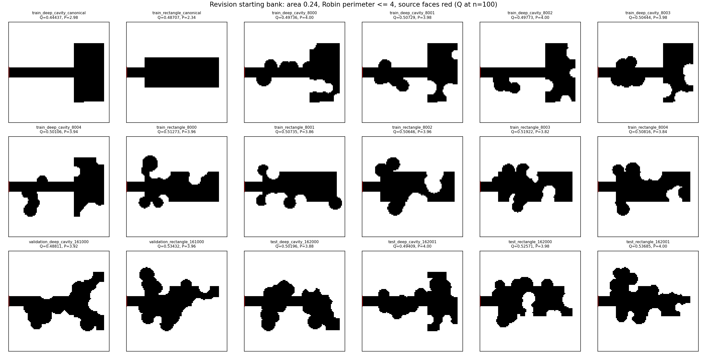
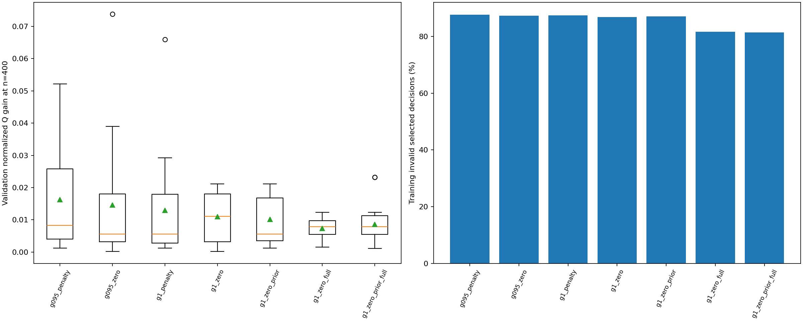
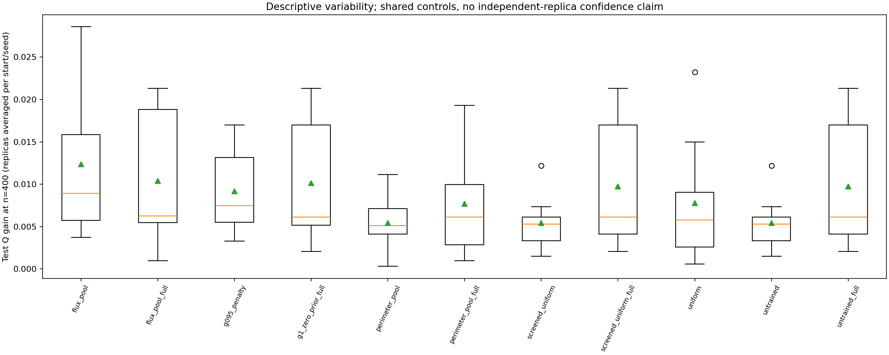

# Reward, physics-prior and feasibility revision results

Completed 2026-10-19. All requested steps are implemented and tested: the reward
ablation, a fixed flux prior with a learned correction, full geometric screening,
and fresh evaluation with training costs included. The study trained **35 policies
across seven settings and 420 episodes**, then completed **176 validation and
152 final-test rollouts**, using **14509 new experimental PDE solves**. No episode
or evaluation exhausted its budget.

The performance hypothesis did not hold in this pilot. Validation preferred the
original discounted, penalized setting. The combined revision reduced invalid
selections, but did not reliably beat the strongest flux heuristic. This does
not support reward misalignment as the main performance bottleneck under this
budget. The reward identity is correct; better learning does not follow from it
automatically. No policy or default is promoted.

## Inspect and reproduce

- [Prespecified protocol and equations](rl_revision_method.md)
- [Complete experiment report](../experiments/20261019T111653094459Z_rl_revision_694225e7/report.md)
- [Summary](data/rl_revision_summary.json), [validation selection](data/rl_revision_selection.json),
  [bank manifest](data/rl_revision_bank_manifest.json), [readiness](data/rl_revision_readiness.json)
- [Training](data/rl_revision_training.csv), [all evaluations](data/rl_revision_evaluations.csv),
  [validation contrasts](data/rl_revision_validation_contrasts.csv),
  [setting costs](data/rl_revision_validation_costs.csv),
  [method summaries](data/rl_revision_method_summary.csv)
- [Paired tests](data/rl_revision_paired_test.csv), [test summaries](data/rl_revision_test_settings.csv),
  [artifact audit](data/rl_revision_artifact_audit.json),
  [production resume check](data/rl_revision_completed_resume.json),
  [selection opportunities](data/rl_revision_test_opportunities.csv),
  [identical final masks](data/rl_revision_mask_identity.json)

```powershell
.\.venv\Scripts\python.exe -m oxygen_shape.cli revise-rl --config configs/rl_revision.yaml
```

`--prepare-only` builds the bank and checks readiness. `--resume "RUN_DIRECTORY"`
requires the same source/config/environment identity. All 35 checkpoints are in
the run's `policies/` directory. Fixed-prior checkpoints save and hash both prior
and residual. Old zero-prior checkpoints remain loadable; eight earlier model
files are unchanged. The completed production resume was tested with every new
rollout call blocked: zero additional PDE solves and unchanged checkpoint hashes.

## Bank, constraints and budgets

The bank has the same 12 development starts and 2 new validation/4 new test
starts. All previous bank hashes are excluded from held-out selection, and all
18 bank hashes are distinct across splits. Held-out starts are selected before
learning by refined Q from three fixed controls and fresh generation seeds.
All 18 generating runs met the unchanged quality rule.



All methods use Bi=1, n=100, area 0.24 within 1e-12, Robin perimeter<=4, a unit
box, fixed source length 0.1 and collar length 0.12, connected no-hole domains,
and the existing operational width-0.04 feature checks at 100/200/400. This is
not an exact continuum neck-width certificate. Perimeter is bounded, not matched.

Every rollout has 17 PDE solves including its initial state and at most 6000
raw disk pairs. Pools have eight candidates and retain the 25% unconditional
slot-zero branch. Full screening validates candidates without solving their PDEs
and records all checks. It improves selected feasibility, not validity per raw
draw. Only measured global delta-Q>1e-7 accepts a geometry. Local flux is a
heuristic feature, not a shape derivative.

## Seven settings and validation

All settings have five replicas and twelve episodes, one full curriculum cycle.
The earlier 24-episode run is not an equal-training-budget comparator. Validation
uses four start/seed pairs per model and averages across all five replicas.
The selected setting and all frozen model digests are saved before final test.

| Setting | Gamma | Invalid penalty | Prior | Screen | Mean normalized validation gain | Training invalid selections |
|---|---:|---:|---:|---|---:|---:|
| g095_penalty | 0.95 | -0.01 | 0 | Cheap | 1.6280% | 87.68% |
| g095_zero | 0.95 | 0 | 0 | Cheap | 1.4594% | 87.32% |
| g1_penalty | 1 | -0.01 | 0 | Cheap | 1.2984% | 87.39% |
| g1_zero | 1 | 0 | 0 | Cheap | 1.1006% | 86.89% |
| g1_zero_prior | 1 | 0 | 1 | Cheap | 1.0169% | 87.08% |
| g1_zero_full | 1 | 0 | 0 | Full | 0.7394% | 81.64% |
| g1_zero_prior_full | 1 | 0 | 1 | Full | 0.8645% | 81.43% |

Removing discounting lowers mean validation gain under both penalties. Removing
the penalty lowers it under both discounts. The prior helps the full-screening
mean but not the cheap-screening mean. These are descriptive results for this
finite budget and two validation starts, not universal claims. The prior has
the largest mean training gain but does not retain that lead on validation.



Validation selects **g095_penalty**. Final test includes all five of its replicas,
all five combined-revision replicas as a prespecified core setting, and nine
controls. The other settings' comparisons above are validation results.

## Fresh final tests

Every method sees four new starts and two seeds. Each learned group has 40
outcomes; each control has eight. Controls are reused across replicas, so the
40 comparisons are **not 40 independent trials**. The following means include
all replicas. Q gains are n=400; eta is n=100 on the same staircase geometry.

| Method/group | Complete outcomes | Mean refined gain Q | Median eta | Median workflow seconds |
|---|---:|---:|---:|---:|
| Uniform | 8/8 | 0.007793 | 0.134286 | 5.466 |
| Screened uniform | 8/8 | 0.005413 | 0.132482 | 3.719 |
| Minimum perimeter | 8/8 | 0.005417 | 0.136004 | 3.844 |
| Current flux | 8/8 | 0.012359 | 0.135025 | 4.288 |
| Untrained | 8/8 | 0.005413 | 0.132482 | 3.687 |
| Full screened uniform | 8/8 | 0.009749 | 0.135670 | 4.115 |
| Full minimum perimeter | 8/8 | 0.007710 | 0.133948 | 4.205 |
| Full current flux | 8/8 | 0.010409 | 0.135006 | 4.153 |
| Full untrained | 8/8 | 0.009749 | 0.135670 | 4.128 |
| Original learned setting | 40/40 | 0.009158 | 0.133730 | 4.071 |
| Combined learned revision | 40/40 | 0.010153 | 0.135670 | 4.135 |

All 152 refined test gains are positive; the smallest is 0.00030645. The combined
setting has a larger mean test gain than the original learned setting despite
losing validation, but the current-flux control mean exceeds both. This does not
justify selecting a model after seeing test results. Higher eta does not imply
the largest total flux Q.

Paired n=400 wins/ties/losses, tolerance 1e-7:

| Learned group | Versus uniform | Versus cheap flux | Versus full flux | Versus full untrained |
|---|---:|---:|---:|---:|
| Original | 30 / 0 / 10 | 19 / 0 / 21 | 16 / 0 / 24 | 20 / 0 / 20 |
| Combined | 22 / 0 / 18 | 10 / 0 / 30 | 7 / 25 / 8 | 5 / 35 / 0 |

The combined learners have **exactly identical final masks** to the full
untrained selector in **35/40** outcomes. Only **4.1--4.2%** of their test pools
offer multiple eligible candidates after full screening. Ranking has no choice
among multiple eligible edits in the rest, though the exploration branch still
acts. This establishes limited decision opportunity, not the sole cause of every
loss. Cheap learners have multiple cheap-pass candidates in 43--48% of pools;
those are not all fully valid.

Combined test invalid selections are 79.08%, versus 88.60% for the original
learned group and 78.95% for the full untrained selector. Most of this feasibility
benefit is available without learning. Eleven coarse/fine classifications change
across all reported model/control pairs; the table therefore uses refined flux.



## Costs and verification

| Phase | New experimental PDE solves |
|---|---:|
| Preparation | 414 |
| Preflight | 67 |
| Training | 7140 |
| Validation search | 2992 |
| Final-test search | 2584 |
| Evaluation refinement | 1312 |
| Total | 14509 |

Each training setting costs 1020 solves. Reused-pioneer generating cost is
another 450 historical solves. Regression-test computations are outside this
experiment count. Preparation and the original training/evaluation invocation
took about 49 minutes, excluding post-run verification/analysis and regression.

Workflow time includes setup, initial geometry validation, final state/trace
serialization and, for evaluation, refinement. Training job time excludes
subsequent checkpoint writes; root invocation time includes them. Environment
and geometry-validation times are separate. These equal-PDE/raw-budget results
are not an equal-wall-time or amortized-speedup result. Storage, trajectories
and execution order also affect measured runtime.

**211 tests pass** and Ruff passes. Tests cover return telescoping, terminal
targets, total-value prior updates, old checkpoint loading, source/Neumann-aware
caching, quotas, validation-only selection and completed resume. The real
completed production resume reloads all 35 checkpoints with new rollouts blocked:
zero new PDE solves, unchanged weights and unchanged experimental solve counts.

The artifact audit verifies all 748 training/evaluation rollouts, 11968 candidate
masks/fields, 712420 raw draws, 93655 decisions, 5104 accepted edits and 97315
full candidate checks. Cache hits are zero; no measured caching benefit is
claimed. It checks source collars, cell counts, concentration bounds, rewards,
probabilities, complete rosters, model digests, refined constraints and costs.
Maximum reward round-trip error is 1.33e-14; maximum conservation error over
the study is **7.2773e-13**. All 74 executed source files and eight previous model
files are unchanged. No post-run label/source repair was needed. Git commit is
null; source snapshots and numerical environment versions preserve provenance.

## Next investigation

Keep flux-guided search as the practical comparison baseline. The tested changes
align the objective and improve selected feasibility but do not establish an RL
advantage. Longer training on the same nearly choice-free full-screened pools is
not supported by this study.

Investigate proposal generation next: learn feasible boundary locations, radii
or paired redistributions before drawing a pool, preserving exploration and
counting every check/solve. Measure whether distinct valid alternatives become
more available before training another controller. Richer geometry/PDE-field
observations are a separate candidate improvement, not a proven remedy. Freeze
a new protocol and final holdout for any revision; these final cases/seeds are
now development knowledge. Family/Bi transfer, equal-wall-time comparisons, MC,
moving-wall derivatives and 3D remain pending or gated. No global-optimality or
clinical conclusion is drawn.
