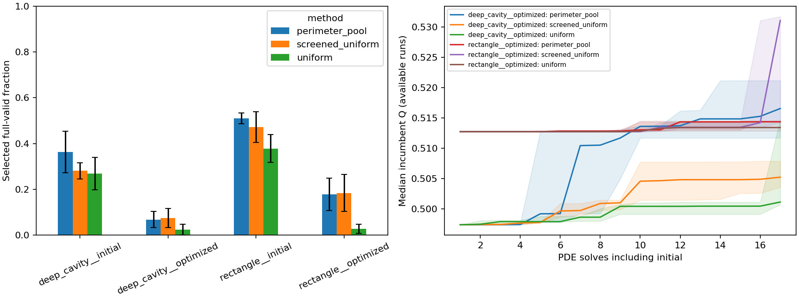

# Cheap-screening ablation results

Completed 2026-10-19. Implemented screened-uniform pool selection and completed
the prespecified audit and all **30 searches**, using **1297 PDE solves**.
Screened-uniform is faster than ordinary sampling in all ten matched pairs on
this machine. It does not consistently beat minimum-perimeter selection on
final flux. The existing defaults, predictors and RL checkpoint remain unchanged.

The additional mathematical result explains what the new rule can offer:
under iid raw proposals and necessary cheap screens, it preserves the ordinary
rejection sampler's conditional distribution of valid edits. It can reduce
full-check overhead without imposing minimum-perimeter ranking. This does not
predict greater flux per PDE solve or a finite-budget performance guarantee.

## Reproduce and inspect

```powershell
.\.venv\Scripts\python.exe -m oxygen_shape.cli benchmark-feasibility --config configs/screening_ablation.yaml
.\.venv\Scripts\python.exe scripts/check_screening_distribution.py
```

- [Prespecified protocol](screening_ablation_method.md)
- [Complete experiment report](../experiments/20261019T023751855710Z_proposal_feasibility_734c514e/report.md)
- [Summary](data/screening_ablation_summary.json), [audit choices](data/screening_ablation_audit.csv),
  [search evaluations](data/screening_ablation_evaluations.csv),
  [search histories](data/screening_ablation_metrics.csv)
- [Shared audit solves](data/screening_ablation_audit_candidate_metrics.csv),
  [contrast refinement](data/screening_ablation_audit_contrasts.csv),
  [input manifest](data/screening_ablation_input_manifest.json),
  [artifact verification](data/screening_ablation_verification.json)
- [Distribution derivation](screening_distribution.md) and
  [exact finite-example check](data/screening_distribution_check.json)

Raw proposals, all candidate masks and concentration fields, configurations,
environment versions, source snapshots and input copies remain in the experiment
directory. Git commit is null because the repository has no commit; the saved
source hashes still match the executed implementation. The mathematical note
and exact check were added during the study without changing its algorithm.

## Rules and fixed inputs

Compare ordinary uniform sampling, minimum-perimeter pools and screened-uniform
pools. Both pool rules draw eight ordinary paired disks and retain a 25% slot-zero
uniform branch. Otherwise screened-uniform chooses uniformly among candidates
passing the same cheap area, protected-collar and perimeter checks; minimum-
perimeter chooses a smallest-perimeter passing candidate. Both fall back to slot
zero if none passes. All eight raw draws are charged. Full geometry validation
and global-Q greedy acceptance remain mandatory.

The two pinned optimized inputs are the first uniform seed-8000 outputs from
the earlier sensitivity benchmark, not best-flux selections. Their Q values are
0.49735743/0.51272518 and Robin perimeters 4.00/3.96. Initial controls are used
in the audit. All cases keep Bi=1, n=100, area=0.24 within 1e-12, perimeter<=4,
the fixed source/collar, connected no-hole topology, unit footprint and the
existing feature-width 0.04 checks at 100/200/400. Metadata, hashes and baseline
Q were verified before any proposals.

Five audit streams 26000-26004 generate 64 pools per case. Both pool rules use
identical raw pools and selection seeds, coupling their uniform branch. All
choices precede full validation and Q evaluation. Search streams 28000-28004
are separate; trajectories diverge after choices and acceptances, so search
trajectories do not share identical physical pools.

## Shared-pool audit

The audit records **10240 raw edits**. Each valid selected mask is solved once
per pool and its response is shared if multiple methods select it: **639 actual
solves for 906 valid selector uses**. Invalid choices have no delta-Q value.
The charged flag identifies first use of a shared solve, not a fair per-method
solve budget. Per-method raw costs are counterfactual deployment costs; shared
audit generation itself is counted once in the overall raw total.

| Fixed case | Uniform valid / 320 | Minimum-perimeter valid / 320 | Screened-uniform valid / 320 | Both pool rules valid / distinct both-valid |
|---|---:|---:|---:|---:|
| Deep cavity, initial | 86 | 116 | 90 | 56 / 25 |
| Deep cavity, optimized | 8 | 22 | 24 | 19 / 0 |
| Rectangle, initial | 121 | 163 | 151 | 105 / 51 |
| Rectangle, optimized | 9 | 57 | 59 | 49 / 3 |

Selected yield improves over slot-zero sampling, but every pool selection costs
eight raw draws. For screened-uniform, valid yield per charged raw draw is
3.52%, 0.94%, 5.90% and 2.30% in table order, versus ordinary sampling's
26.88%, 2.50%, 37.81% and 2.81%. It is not an improvement per raw draw.

Retrospective one-step greedy gain is actual delta-Q when above the existing
improvement threshold, otherwise zero, including zero for invalid selections.
The paired mean-gain difference is first averaged within each 64-pool replicate;
the following table summarizes those five replicate differences.

| Fixed case | Median screened-minus-minimum mean gain per choice | Replicate wins / ties / losses |
|---|---:|---:|
| Deep cavity, initial | -3.3038e-5 | 2 / 0 / 3 |
| Deep cavity, optimized | 0 | 2 / 2 / 1 |
| Rectangle, initial | +1.4933e-4 | 3 / 0 / 2 |
| Rectangle, optimized | +9.0751e-7 | 4 / 0 / 1 |

Medians of paired differences need not equal differences of medians. These are
coarse fixed-state diagnostics, not a sequential search result. In particular,
the optimized deep cavity has no distinct both-valid pair, and the optimized
rectangle has only three. Those cases cannot reliably isolate a within-valid
ranking effect. Both-valid conditioning also describes a selected subset of
pools, not all proposals.

Six prespecified extreme both-valid contrasts are available across the other
cases, with both positive and negative directions. All retain their signs at
200/400. Both directions for the optimized deep cavity are explicitly marked
unavailable. Extremes are descriptive checks, not representative average effects.

## Equal-PDE-budget search

Every run meets its 17-solve budget, including its own initial solve, within the
6000-raw-draw cap. Execution order rotates by seed. All initial/final search
geometries are solved again at 200/400.

| Frozen input | Method | Final Q median [Q1, Q3] | Median eta | Median raw draws / selected checks | Median search seconds |
|---|---|---:|---:|---:|---:|
| Deep cavity | Uniform | 0.501119 [0.500695, 0.514678] | 0.130629 | 872 / 872 | 7.946 |
| Deep cavity | Minimum perimeter | 0.516542 [0.511698, 0.521160] | 0.133819 | 760 / 95 | 3.195 |
| Deep cavity | Screened uniform | 0.505213 [0.503566, 0.507877] | 0.127809 | 1592 / 199 | 3.408 |
| Rectangle | Uniform | 0.513407 [0.512835, 0.514487] | 0.129476 | 385 / 385 | 7.147 |
| Rectangle | Minimum perimeter | 0.514358 [0.514339, 0.514477] | 0.129236 | 856 / 107 | 3.990 |
| Rectangle | Screened uniform | 0.531065 [0.514210, 0.531727] | 0.133820 | 688 / 86 | 4.113 |

Screened-uniform wins final Q against ordinary sampling on 3/5 deep-cavity
seeds and 2/5 rectangle seeds, with one rectangle tie. Against minimum-perimeter
it wins 2/5 seeds in each family. All pairwise win/loss/tie classifications
persist at 100/200/400 using absolute tolerance 1e-7. Higher rectangle median Q
does not imply winning most matched seeds; magnitudes and variability matter.

Screened-uniform is faster than ordinary sampling in all ten pairs. Median
paired uniform/screened elapsed-time ratios are **2.04** for deep cavity and
**1.88** for rectangle. It is faster than minimum-perimeter in 3/5 pairs per
family; there is no uniform speed advantage between the two pool rules.
Timing includes generation, selection, full validation, PDE solves and candidate
storage on one machine. These ratios are medians of paired ratios, not ratios
of medians, and should not be generalized across hardware or inputs.



Audit bars include replicate SD; search curves include interquartile bands.
These summarize five seeds, not confidence intervals or independent geometries.

## Mathematical interpretation

With iid raw edits and fully valid set F contained in cheap-pass set S,
uniform selection among passing slots weights every member of F by the same
factor. Its conditional valid-edit law matches ordinary rejection sampling.
Minimum-perimeter choice generally changes that law. The derivation includes
fallback and exploration, degenerate cases and finite-cap limitations; exact
rational enumeration checks a finite example. All **10240 observed raw edits**
satisfy the necessary-screen relation, and selection/exploration traces match
the declared rules. Observations are not an all-geometries certificate.

The unconditional selected-edit distribution does change: more choices pass
the screens. This is compatible with an unchanged distribution conditional on
full validity. Finite raw/time caps and conditioning on completion need separate
care. Equal transition laws without binding caps predict neither identical
seeded paths nor higher expected flux per PDE solve. The finite-sample Q
differences here do not establish or refute that analytical statement.

## Validation, costs and decision

**1297 solves = 4 input checks + 639 shared audit responses + 24 audit contrast
refinements + 510 search + 120 search refinements.** Full workflow time is
388.5 seconds on this machine. Maximum conservation error is 5.0939e-13.
All saved search candidates meet the area and perimeter budgets, coarse
incumbent Q is nondecreasing, final refined gains are nonnegative, and source
hashes remain unchanged. Candidate mask hashes, selection traces, shared solve
counts, exact budgets and executed source hashes were verified after the run.
Staircase refinement is not a continuum error bound.

The full regression suite passes **192 tests**; lint and format checks pass.
Tests cover selection support, nonminimum choices, coupled exploration,
selection-before-validation, cost sharing, missing contrast directions,
refinement orientation, strict raw caps, global-Q rejection and replay.
The separate exact rational check also passes.

Screened-uniform is a useful experimental implementation for reducing overhead
without intentional valid-edit ranking bias. It is not evidence that RL or
sensitivity guidance beats uniform in PDE budget. One frozen incumbent per
family, one Bi and five seeds limit generality; no default or checkpoint is
promoted from this experiment.

Next, prespecify an equal-wall-time comparison of ordinary and screened-uniform
sampling across multiple frozen incumbents per family and fresh seeds. Record
all raw/check/solve costs and incomplete runs; keep minimum-perimeter as a
separate biased proposal option. This tests whether measured overhead savings
translate into better flux under a time budget. Advanced Monte Carlo and 3D
remain behind the existing scientific validation gates.
