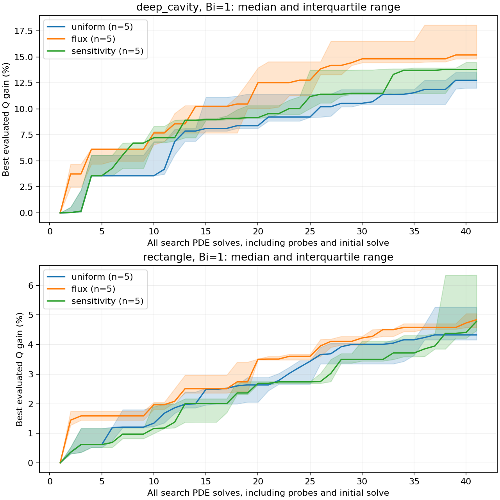
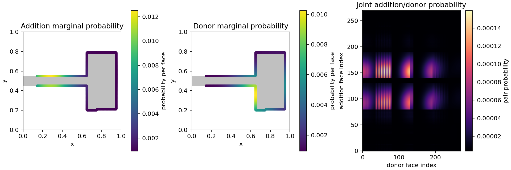

# Empirical sensitivity-guided search: first comparison

The sampler implementation and comparison are complete. A reliable advantage
over uniform/flux guidance has **not** been established, so the scientific
advantage gate remains open.

Reproduce the comparison:

```powershell
.\.venv\Scripts\python.exe -m oxygen_shape.cli benchmark-sensitivity --config configs/sensitivity_benchmark.yaml
```

The [full report](../experiments/20261018T233304507960Z_sensitivity_benchmark_4f9b50bb/report.md)
contains IQRs, paired comparisons, target-solving counts and costs.
[Method and derivation](sensitivity_method.md) describe the signed finite-pair
response, uniform exploration, fixed-geometry probes and limitations.

## Protocol and verification

Five fresh seeds (8000–8004), two initial shapes, Bi=1 and three methods give
30 runs. Each pays for 41 search PDE solves. Sensitivity uses four uniform probes
and four guided proposals in each eight-candidate round, then discards its map.
Probes also compete for acceptance. A joint kernel map smooths global delta-Q
per reallocated area; it is not a continuum shape derivative.

All methods use the same batch-greedy schedule and geometric constraints:
area 0.24 within 1e-12, Robin perimeter <=4, fixed source length/location,
protected collar x<0.12, unit box, source connectivity, no holes and feature
width 0.04. Candidates pass morphology checks on 100/200/400 grids. Final
states undergo full PDE refinement at 200/400 using the same staircase masks.
The batched uniform control differs from the earlier single-candidate optimizer;
this report makes no direct performance comparison with that older protocol.

All 30 runs meet their budgets and final constraints. There are **1230 search
solves, including 200 probe solves, plus 120 refinement solves**. Every final
gain exceeds its observed last-grid sensitivity. Maximum conservation error
across evaluated candidates and refinement is 4.37e-13 or less.

The full regression suite passes **152 tests**. New tests verify signed response
weighting, joint pair dependence, uniform limits, exploration mass, frozen-base
probing, real solve counts, partial rounds, attempt exhaustion, geometric
constraints, stale-cache rejection, maps and reproducibility. Ruff lint and
format checks pass. Boundary caching is shared by all three methods and tested
to preserve seeded proposals exactly.

An earlier pilot overlapped regression tests and was interrupted to isolate
timing. Its artifacts remain in the experiment directory ending `72c7cf43` and
are excluded from the primary comparison. The primary sweep began after those
tests completed, with unchanged settings. No model was selected or promoted.

## Results

| Shape | Method | Median final Q | Median search seconds | Median seconds including refinement | Finest-grid wins vs uniform |
|---|---|---:|---:|---:|---:|
| Deep cavity | Uniform | 0.50105519 | 8.93 | 11.60 | — |
| Deep cavity | Flux | 0.51186326 | 11.00 | 14.31 | 4/5 |
| Deep cavity | Sensitivity | 0.50570729 | 12.78 | 15.74 | 3/5 |
| Rectangle | Uniform | 0.50815731 | 7.22 | 10.36 | — |
| Rectangle | Flux | 0.51066466 | 7.52 | 10.89 | 3/5 |
| Rectangle | Sensitivity | 0.51039240 | 6.84 | 9.80 | 3/5 |

Sensitivity's median **paired** Q difference against uniform is +0.00145116
on the deep cavity and +0.00364798 on the rectangle. Those quantities differ
from differences of the column medians. All six positive finest-grid paired
differences also exceed the reported empirical ranking-sensitivity criterion.
Sensitivity beats flux on only 2/5 deep-cavity seeds and 1/5 rectangle seeds.
IQRs overlap substantially; five seeds do not establish statistical superiority.

Every deep-cavity run reaches a 10% gain over its initial Q. Median solves to
that target are uniform 26, flux 14 and sensitivity 23, including probes and
the initial solve. No rectangle run reaches that target within 41 solves; those
unreached cases must not be omitted when discussing target-solving efficiency.





The map shows derived sampling probabilities. Its joint addition/donor field
is preserved with the signed probe responses, area reallocation, coordinates
and base mask, allowing reconstruction of the empirical response field.

## Interpretation and next experiment

The method finds feasible improvements and sometimes improves solve efficiency,
but this sparse empirical map is not consistently better than the simpler flux
control. It takes longer on the deep cavity; the small rectangle timing
difference does not establish a general speedup. No transfer to other Bi values
or initial geometries has been tested here.

The next diagnostic should measure predictive accuracy on new paired edits at
a fixed geometry, including radius dependence and failures of feasibility.
Separate sensitivity per reallocated area from absolute delta-Q as an ablation,
count all probing costs, and evaluate revisions on fresh seeds rather than
tuning against 8000–8004. Keep flux guidance as a strong baseline. Monte Carlo,
moving-Robin derivatives and 3D remain behind the existing validation gates.

Data: [evaluations](data/sensitivity_evaluations.csv),
[summary](data/sensitivity_summary.json). The full experiment retains each
config, mask, field, proposal/rejection log, round history, probe table,
joint map, refinement solve, source snapshot and environment provenance.
