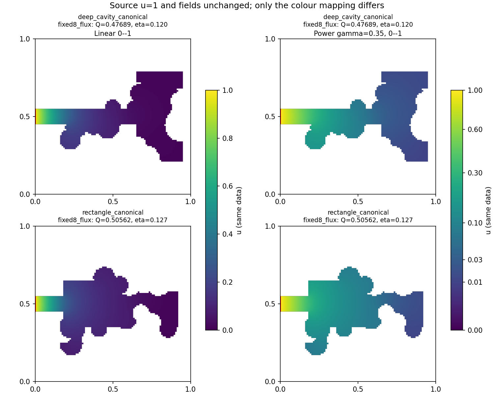

# Source concentration suggestion: assessment and applied display improvement

The observation is valid: the shared linear 0--1 color scale compresses the
low-concentration part of the images. In the displayed deep-cavity fixed8
endpoint, minimum u is 0.01013 and median u is 0.02533. Most of the dark region
is small but nonzero concentration, not an empty region or a failed solve.

Increasing source amplitude does increase absolute concentration and transfer.
In our present linear model it does not change relative screening, normalized
concentration, membrane utilization or the ranking of geometries. Scaling the
same source driving difference in every case adds no information to that ranking.

## Validated mathematical distinction

For a fixed, prescribed uniform blood concentration Cb and constant D and W,

\[
C_a-C_b=a(C_1-C_b),\quad
\Phi_a=a\Phi_1,\quad
u_a=u_1,\quad Q_a=Q_1,\quad\eta_a=\eta_1.
\]

Here the first flux is dimensional; Q is normalized to the new concentration
drive. The auxiliary diagnostic instead uses a fixed concentration reference v,
with v_D=a and Q_v=a*Q. The ordinary normalized solver always retains u_D=1.
See [the derivation and assumptions](source_amplitude_derivation.md).

The independent validation solves scaled matrix right-hand sides for source
factors 1, 2 and 5 at Bi=0.1, 1 and 10, on an analytical slab and two saved
irregular chamber endpoints. The two chambers share area 0.24, source length
0.1 and a Robin perimeter upper bound of 4. The slab validates the formula and
is excluded from chamber ranking comparisons.

All 27 new PDE solves pass. The largest difference between normalized fields
is 8.88e-16; normalized flux differs by at most 4.44e-16. Eta remains invariant
within 1e-11, and the chamber ranking is unchanged at every tested Bi. Maximum
conservation error is 1.03e-12, below the 1e-9 relative tolerance. For Bi=1 the
normalized independently solved fields also match the original saved fields.

## Applied change

Added a second view using a common power color normalization, gamma=0.35,
with fixed bounds 0--1 for every geometry. Colorbar numbers remain actual u.
All normalized source values remain 1; fields, Q, eta, geometry masks and
optimization results are unchanged. The linear reference view remains available.
The power mapping is explicitly labeled; never compare colors across the two
different mappings without reading their colorbars. Within each mapping,
identical colors represent identical concentrations in every geometry.



[All twelve geometries, shared power scale](figures/source_display_power.png)
and [shared linear reference](figures/source_display_linear.png).

This improves human inspection only; it does not change the numerical fields
or features passed to the current optimizer. Changing source width or Bi would
change the physical problem and needs a separately defined comparison; neither
is changed here to brighten a figure.

## Reproduction

Run:

```powershell
.\.venv\Scripts\python.exe scripts/validate_source_display.py experiments/20261019T122613613156Z_feasible_pool_b8b49d2b --gamma 0.35
```

[Experiment totals and source snapshot](../experiments/20261019T132217526903Z_source_amplitude_display_6e34a27f/summary.json),
[all source-amplitude checks](data/source_display_metrics.csv),
[displayed field statistics](data/source_display_statistics.csv).
All 48 referenced input files were hash-checked unchanged after producing the
new figures. New experiment config, seed 191000, tolerances, exact source code,
scaled and normalized arrays, input hashes and Git provenance are retained.
The full regression suite passes 226 tests, including nine new source-scaling
and scientific-display checks. Ruff checks and formatting pass; all 78 executed
source-file hashes match the experiment snapshot.
