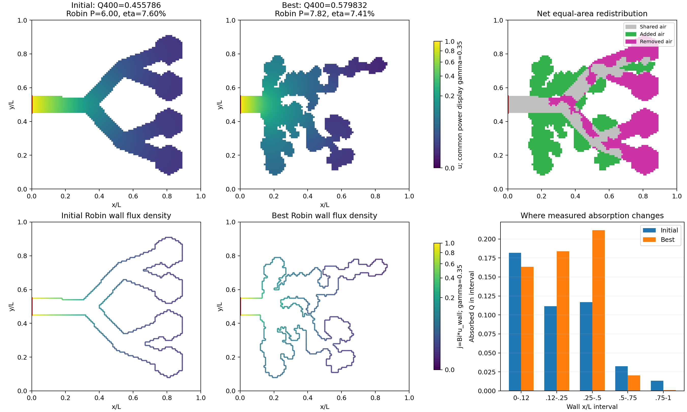

# Selected geometry: measured absorption and resource redistribution

Selected returned endpoint: acinar_sacs, flux_anneal,
phase deep, search seed 320000; charged search solves
1025. Q400 rises from 0.455786250 to 0.579831643
(27.216%). Area remains 0.24. Actual perimeter changes
from 6.000 to 7.820.
Eta is diagnostic, not the optimization objective. Red marks the unchanged source.
Fields and boundary colors share explicitly labeled power normalizations.

| Wall x range | Initial Q | Best Q | Change Q | Initial membrane length | Best membrane length |
|---|---:|---:|---:|---:|---:|
| 0.00-0.12 | 0.181674 | 0.163219 | -0.018455 | 0.240 | 0.240 |
| 0.12-0.25 | 0.111452 | 0.183671 | +0.072219 | 0.270 | 1.520 |
| 0.25-0.50 | 0.116978 | 0.211738 | +0.094760 | 1.320 | 3.250 |
| 0.50-0.75 | 0.032433 | 0.020313 | -0.012120 | 2.060 | 2.400 |
| 0.75-1.00 | 0.013249 | 0.000891 | -0.012358 | 2.110 | 0.410 |

The absorption bins sum to the global objective and locate its measured change.
The x<0.12 collar geometry is protected, but its absorption can change because
the PDE field is global. Net additions/removals have exactly equal area. Changes
in wall amount and accessibility occur together; these bins are not a shape
derivative or an isolated causal decomposition. The separate exact-perimeter
study supplies a within-start control for membrane growth.

Selection uses the completed study's independent FEM rule. Numerical bounds
must still be consulted for unresolved close rankings. This is a post-hoc
illustration, with unequal effort across study phases, not a globally optimal
shape or proof of superior natural acini. This figure reuses saved fields and
performs zero new PDE solves. A vector PDF is supplied alongside the PNG.
