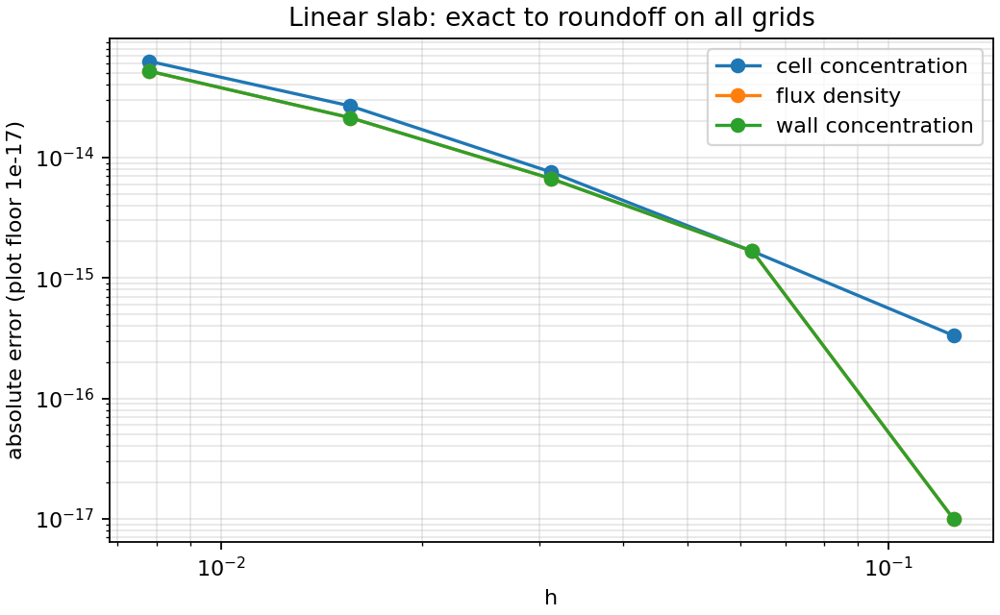
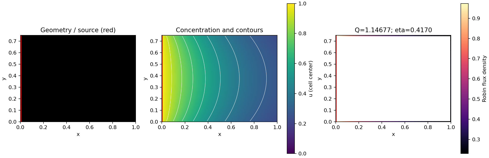
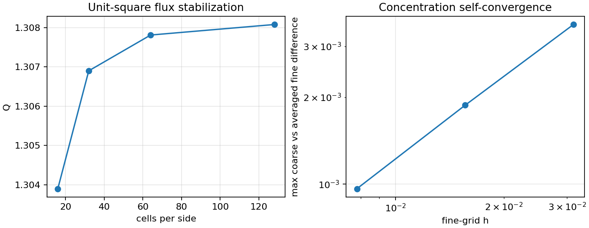

# Milestones 0 and 1: numerical validation

Validated on 2026-10-18 with Python 3.10.0, NumPy 2.2.6, SciPy 1.15.3,
and double-precision arithmetic. These results validate the deterministic
reference; they are not shape-optimization results.

## Implementation delivered

- `physics/`: dimensionless parameters, diagnostic tolerances, and physical metrics.
- `geometry/`: square-cell masks, explicit exposed faces, rectangles, connectivity,
  and source-protection validation.
- `solvers/`: analytical slab, sparse finite-volume assembly, source and membrane
  fluxes using the assembly conductances, conservation, residual, and bounds checks.
- `experiments/`: strict YAML configurations, unique output folders, saved states,
  per-face fluxes, full installed-package versions, Git provenance, and source snapshots.
- `viz/`: geometry, concentrations, contours, source, Robin flux density, slab errors.
- `cli.py`, example configurations, README, derivation, and seven test modules.

## Checks executed

```powershell
.\.venv\Scripts\python.exe -m pytest -q
.\.venv\Scripts\python.exe -m ruff check src tests
.\.venv\Scripts\python.exe -m oxygen_shape.cli validate-1d --config configs/slab_1d.yaml
.\.venv\Scripts\python.exe -m oxygen_shape.cli solve --config configs/rectangle_2d.yaml
```

Result: **60 tests passed in 7.36 s**; Ruff: **All checks passed**. Tests cover
the slab at six permeabilities, three lengths, and four grid sizes; zero
permeability; a hand-derived single-cell balance; constant Dirichlet data; matrix
symmetry and positivity; concentration bounds; mass conservation; reflection
symmetry; non-linear 2D refinement; invalid/disconnected geometries; protected
source location, exposure, length, and spacing; strict configurations; CLI failure;
output files; source-snapshot hashes; and repeated deterministic results.

## Analytical slab

`Bi=1`, length one, three transverse cells, zero-Neumann top/bottom, source left,
Robin membrane right. Exact flux per unit transverse width is `q=0.5`.

| nx | h | max center error | flux-density error | conservation error |
|---:|---:|---:|---:|---:|
| 8 | 0.125 | 3.33e-16 | 0 | 0 |
| 16 | 0.0625 | 1.67e-15 | 1.67e-15 | 7.99e-15 |
| 32 | 0.03125 | 7.55e-15 | 6.66e-15 | 1.81e-14 |
| 64 | 0.015625 | 2.68e-14 | 2.14e-14 | 1.38e-13 |
| 128 | 0.0078125 | 6.28e-14 | 5.20e-14 | 4.45e-13 |

Maximum membrane concentration error: `5.21e-14`. The discretization is exact for
a linear field, so the increasing roundoff at fine grids is expected. No
convergence order is fitted. The strip width changes with h; the reported flux
error is per unit width. Full per-grid geometry and face data are saved.



Run directory: `experiments/20261018T185011700308Z_validate_1d_263ccb0d/`.

## Rectangle example

Bounding box `[0,1] x [0,0.75]`, grid `(ny,nx)=(60,80)`, `h=0.0125`, `Bi=1`.
The entire left edge is the fixed source; other edges are Robin.

| Quantity | Result |
|---|---:|
| Area | 0.75 |
| Source length | 0.75 |
| Robin perimeter | 2.75 |
| Q | 1.146769776493988 |
| Source influx | 1.146769776494017 |
| Q_ideal | 2.75 |
| eta | 0.417007191452359 |
| Relative conservation error | 2.50e-14 |
| Infinity norm of algebraic residual | 3.33e-15 |



Run directory: `experiments/20261018T185011701309Z_rectangle_b52e178c/`.

## Non-linear 2D refinement

This is a separate **unit square**, not a comparison with the preceding rectangle.
All grids represent the same area one, source length one, Robin perimeter three,
and `Bi=1`. The left edge is the source. Fine concentrations are averaged over
2-by-2 cells before comparison with the preceding coarse grid.

| Cells per side | Q | eta | max field change from preceding grid | conservation error |
|---:|---:|---:|---:|---:|
| 16 | 1.303899906048 | 0.434633302016 | — | 1.70e-16 |
| 32 | 1.306898836377 | 0.435632945459 | 0.00356729 | 2.11e-14 |
| 64 | 1.307809114030 | 0.435936371343 | 0.00187578 | 8.12e-14 |
| 128 | 1.308077003494 | 0.436025667831 | 0.000963893 | 1.64e-13 |

The last flux change is about **0.0205%**. Both successive flux differences and
field differences decrease. This establishes self-convergence for this example,
not an exact continuum error bound. Individual runs retain complete output;
`experiments/refinement_results.json` indexes the four runs.



To reproduce the refinement experiments after installation, execute this Python
code from the repository root (each call writes a complete experiment folder):

```python
from pathlib import Path
from oxygen_shape.experiments.config import SolveConfig
from oxygen_shape.experiments.runner import run_solve

for n in (16, 32, 64, 128):
    output, summary = run_solve(SolveConfig(
        output_root=Path("experiments").resolve(),
        geometry={"nx": n, "ny": n, "h": 1/n},
    ))
    print(n, summary["final_Q"], summary["conservation_error"], output)
```

## Provenance and limits

Every run saves `config.yaml`, `metrics.csv`, `initial_geometry.npy`,
`final_geometry.npy`, `concentration.npy`, `boundary_faces.csv`, `summary.json`,
`run.log`, and figures. Summary includes seed 42, grid, Bi, direct solver,
diagnostic tolerances, installed versions, Git state, timing, Q, eta, and resources.
The direct solve has no iterative tolerance; `solver_tolerance` is null.

This repository has no commits yet, so the recorded Git commit is null and dirty
state is true. Exact Python sources, pyproject, and AGENTS.md are preserved in each
run's `source_snapshot/` with SHA-256 hashes in `source_manifest.json`.
The recorded seed is metadata; these deterministic workflows consume no randomness.

The validated scientific examples are axis-aligned rectangles and slabs. A
nonrectangular mask has an algebraic conservation regression, not a continuum
accuracy claim. Raster staircases can bias perimeter. Source/Robin corners can
reduce field convergence order; the permeability-limit test uses separated slab
boundaries to avoid a source/absorber corner singularity. At Bi=0, the solution is
exactly one, Q is zero, and eta is undefined. Solver-level validation does not yet
enforce the area/perimeter/neck constraints needed by a future optimizer.
Shape comparisons, optimization, Monte Carlo, GPU work, and 3D remain later stages.

Next example command:

```powershell
.\.venv\Scripts\python.exe -m oxygen_shape.cli solve --config configs/rectangle_2d.yaml
```
