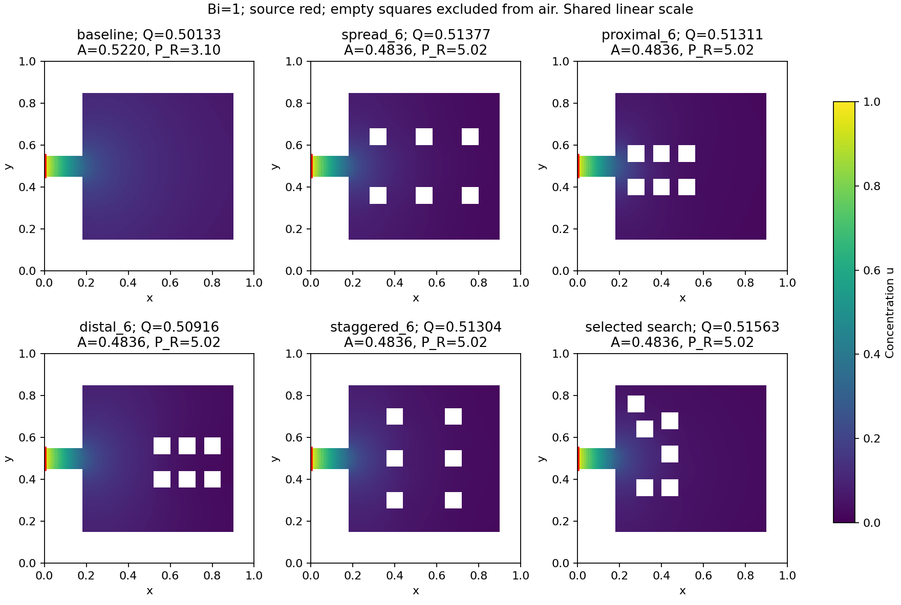
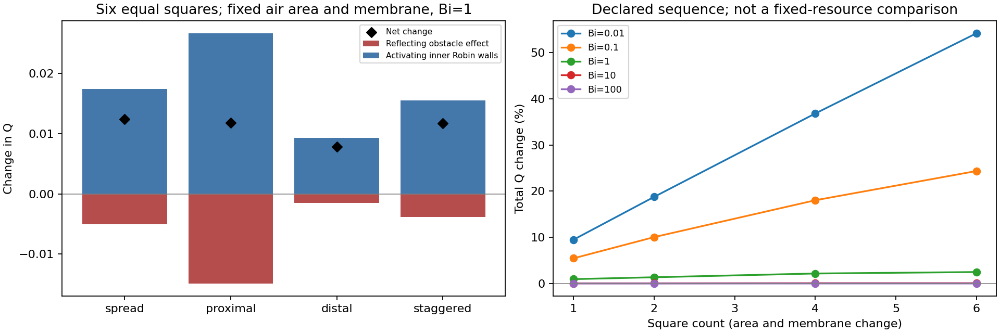

# Square-island study

Exploratory 2D results; separate from v0.1.0.

An empty square is excluded material, not a source or an inter-alveolar pore.
Exterior source/wall labels are fixed. Maps compare positions at the same square size;
six-square layouts and relocation hold air area and Robin length fixed.
Count curves change both resources and must not be interpreted as a free topology gain.

Committed FVM solves: 3493; FEM solves: 418.
Possible uncommitted work upper bound: 0.

## Equal-resource six-square layouts, Bi=1

| Layout | Q0 | Q_R | Q_N | Net change (%) | Inner-wall Q | Air area | Robin length |
|---|---:|---:|---:|---:|---:|---:|---:|
| spread_6 | 0.5013273 | 0.5137722 | 0.4963173 | 2.4824 | 0.1283317 | 0.48360 | 5.020 |
| proximal_6 | 0.5013273 | 0.5131073 | 0.4864559 | 2.3498 | 0.1504723 | 0.48360 | 5.020 |
| distal_6 | 0.5013273 | 0.5091563 | 0.4998289 | 1.5617 | 0.0912512 | 0.48360 | 5.020 |
| staggered_6 | 0.5013273 | 0.5130424 | 0.4974904 | 2.3368 | 0.1223018 | 0.48360 | 5.020 |

## Refinement on the identical polygons

| Case | Q at finest FVM | Q at finest FEM | Finest FEM net change (%) |
|---|---:|---:|---:|
| layout/spread_6 | 0.5150152 | 0.5157456 | 2.5367 |
| layout/proximal_6 | 0.5145702 | 0.5154841 | 2.4848 |
| layout/distal_6 | 0.5103069 | 0.5109501 | 1.5833 |
| layout/staggered_6 | 0.5142793 | 0.5150036 | 2.3892 |
| search/uniform_greedy_420002 | 0.5169566 | 0.5177232 | 2.9299 |

The displayed search endpoint is selected post hoc among returned
coarse-grid endpoints, with additional search effort relative to static layouts.

## Placement feasibility

| Family | Square width | Eligible positions | Rejected positions |
|---|---:|---:|---:|
| maze_chamber | 0.04 | 56 | 113 |
| maze_chamber | 0.08 | 49 | 95 |
| rectangle | 0.04 | 21 | 148 |
| rectangle | 0.08 | 12 | 132 |
| hexagon | 0.04 | 18 | 151 |
| hexagon | 0.08 | 12 | 132 |
| acinar_sacs | 0.04 | 0 | 169 |
| acinar_sacs | 0.08 | 0 | 144 |
| maze | 0.04 | 0 | 169 |
| maze | 0.08 | 0 | 144 |

## Numerical and interpretation limits

Refinement rows: 340; independent FEM rows: 170.
Selected map extrema are chosen on the coarse grid; validation_selection.json records
that selection. This does not refine every placement or prove global rankings.
FVM subdivisions and FEM solve the same staircase exterior and exact square holes.
No smooth anatomical boundary, 3D pore, convection or blood-side coupling is modeled.
Search curves use one starting maze and multiple search seeds; IQR is variability,
not a confidence interval. The proposal heuristic is not RL or a shape derivative.
No-fit families, rejected placements and paid rejected candidates are retained.
The obstruction/activation decomposition is a controlled comparison; inner uptake
alone is not the net gain because concentration on the exterior wall also changes.

Close prior work includes [Freus & Freus 2015](https://doi.org/10.17512/jamcm.2015.2.01)
and [Grebenkov & Traytak 2019](https://doi.org/10.1016/j.jcp.2018.10.033).
No first-study or biological-optimality claim follows from these computations.
